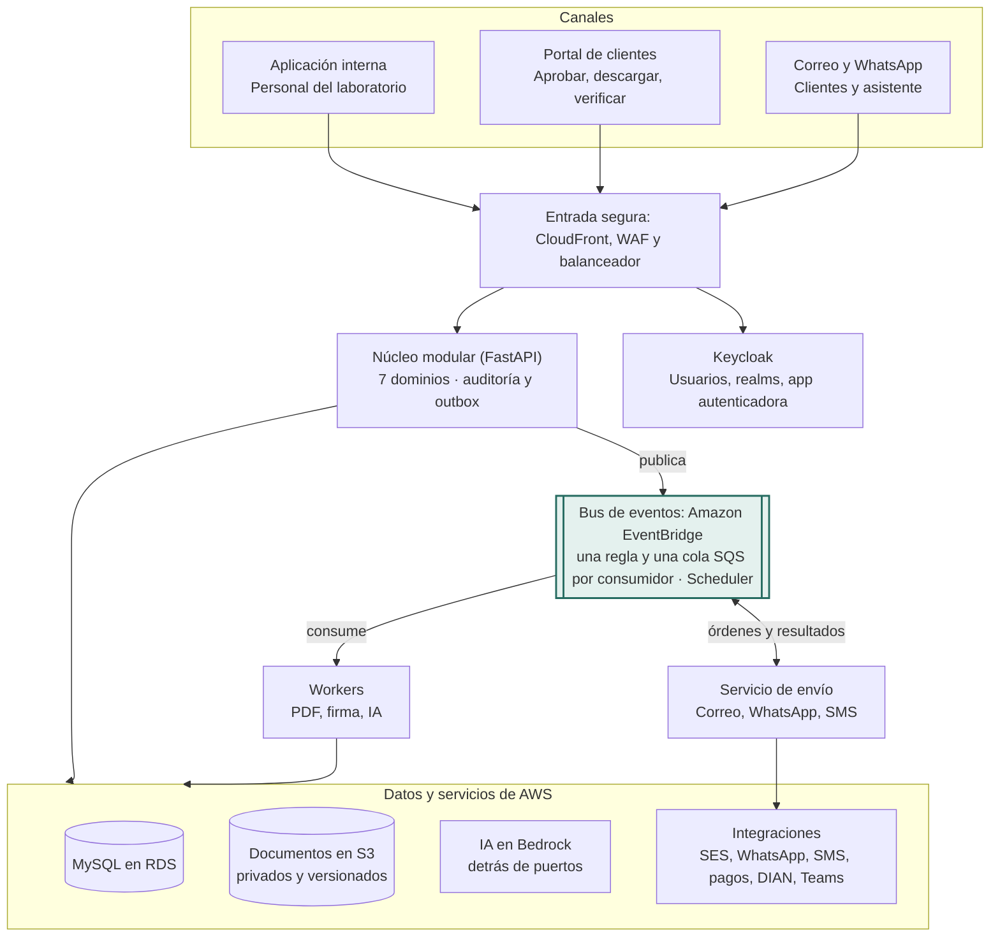

# Blueprint: plataforma de gestión de Laboratorios M&G

11 de octubre de 2026 · Javier Humberto Ortiz Molina

> **Confidencial.** Documento de propiedad de Javier Humberto Ortiz Molina. Contiene el diseño técnico de la solución y se comparte solo bajo el acuerdo de confidencialidad firmado.

Este blueprint describe la solución completa: dominios de negocio, alcance funcional, flujo de extremo a extremo, modelo de datos, arquitectura, lineamientos de desarrollo, infraestructura, integraciones, inteligencia artificial, seguridad, requisitos no funcionales, migración, validación, forma de trabajo del equipo, entrega por fases y decisiones pendientes.

**Estado: versión preliminar.** Está construido con lo levantado en la reunión con el laboratorio y sus notas posteriores. Se cierra al final de la fase 0, con el diagnóstico de los sistemas actuales y las respuestas del cuestionario. Las decisiones que dependen de esas respuestas están marcadas como pendientes en la última sección.

Las referencias a requisitos (R1 a R22) corresponden a la lista de requisitos levantados con el laboratorio.

## 1. Visión, objetivos y principios

**Visión.** Una sola plataforma donde cada muestra tiene una hoja de vida completa, desde la solicitud hasta la destrucción de la contramuestra, con trazabilidad total para la acreditación y con inteligencia artificial en las tareas repetitivas, para que M&G crezca en laboratorios, sedes y países sin crecer al mismo ritmo en trabajo manual.

**Objetivos medibles**

- **Cero códigos de muestra manuales:** todo ingreso genera código y hoja de vida en el sistema.
- Toda orden ejecutada con una cotización aceptada y registrada.
- Estado de cualquier muestra y ensayo consultable en segundos, sin buscar en el correo.
- Resultados que pasan del Excel del analista al informe sin transcripción manual.
- Cada acción del sistema registrada con quién, qué, cuándo, valor anterior y nuevo.

**Principios de diseño**

| Principio | Qué significa en la práctica |
| --- | --- |
| Trazable por diseño | La auditoría no es un módulo final: toda escritura pasa por el registro de auditoría desde el primer día. Nada se borra físicamente: se elimina de forma lógica (restaurable) o, si es un documento emitido, se anula. |
| La IA propone, una persona decide | Ninguna acción de IA aprueba, firma ni envía por sí sola algo que comprometa al laboratorio. |
| Configurable antes que programado | Sedes, laboratorios, roles, firmantes, plazos, plantillas y políticas se ajustan sin desarrollo. |
| Confidencialidad por defecto | El analista no ve la identidad del cliente; los cuadernos de carga solo los ve quien los necesita. |
| Convivir y absorber | Se aprovecha lo que funciona (datos y lógica de metrología y del módulo de ingreso), se absorbe en la plataforma y se migra por partes, sin un cambio de golpe. |
| Simple de operar | Un solo sistema modular, servicios administrados en la nube y un equipo pequeño capaz de mantenerlo. |

## 2. Dominios de negocio

La solución se organiza en 7 dominios de negocio (contextos delimitados), un número manejable para un equipo pequeño: cada developer puede hacerse cargo de dos o tres dominios completos. Cada dominio es dueño de sus datos y reglas, y los demás solo lo usan a través de su interfaz interna. Esto permite construir por fases, probar por partes y extender (nuevas sedes, laboratorios o países) sin reescribir.

| # | Dominio | Responsabilidad | Módulos | Requisitos |
| --- | --- | --- | --- | --- |
| 1 | Plataforma | Sedes, laboratorios, usuarios, roles, permisos, firmantes, configuración, numeración y auditoría | Administración, Auditoría | R6, R14, R20, R21, R22 |
| 2 | Clientes y comercial | Clientes, sedes y contactos, documentos, política de pago, solicitudes, cotizaciones, aprobaciones y solicitudes de cambio | Clientes, Solicitudes y cotizaciones | R1, R2, R4, R11, R17 |
| 3 | Normas y catálogo | Normas por país y versión, cuadernos de carga, ensayos, precios y acreditaciones | Gestión de normas, Catálogo | R1, R2, R10, R20 |
| 4 | Muestras | Órdenes, ingreso, código y hoja de vida, fotos, inspección, cantidades, traslados y contramuestras | Ingreso, Seguimiento, Contramuestras | R5, R7, R9, R12, R13, R19 |
| 5 | Laboratorio | Planificación, asignación, equipos y metrología, plantillas y resultados | Metrología, Planificación, Ensayos y resultados | R8, R18 |
| 6 | Informes y entrega | Borrador, revisión, aprobación, firma, QR, informes modificados, pagos, factura electrónica y descargas | Informes, Entrega y pagos, Portal de clientes | R3, R4, R6, R15, R16 |
| 7 | Comunicaciones | Bandeja de correo y WhatsApp, asociación a órdenes, registro de comunicaciones (COM), plantillas, avisos al cliente, asistente y alertas internas | Registro de comunicaciones, Plantillas, Asistente | R12, R17, R22 |

**Analítica** no es un dominio: es una capacidad de solo lectura que consulta los datos de todos (listas básicas en el MVP; tableros, indicadores de gestión y consultas con IA en fases posteriores).

**Quién genera cada número**

| Identificador | Dominio responsable | Cuándo se crea |
| --- | --- | --- |
| Número de cotización | Clientes y comercial | Al crear la cotización, aunque no se acepte |
| Número de orden interno | Muestras | Al registrar la solicitud de cotización; si el cliente no pidió nada y envía la muestra, al llegar la muestra a recepción (y el sistema genera la cotización). El cliente puede usar ese número en el paquete y en sus mensajes. Si la cotización vence sin aceptación ni muestra, la orden se cierra como "no concretada" |
| Código de M&G de cada muestra | Muestras | Al ingresar la muestra en recepción |
| Identificador de cada ensayo (por ejemplo, 267498-03) | Laboratorio | Al planificar los ensayos de la muestra |
| Número de informe | Informes y entrega | Al emitir el informe |
| Identificador de cada comunicación (por ejemplo, COM-2026-000123) | Comunicaciones | Al recibir o enviar cualquier comunicación, o al registrar una manualmente (captura o exportación de un chat de WhatsApp, nota de una llamada o reunión) |
| Identificador de recepción de un paquete (por ejemplo, RCP-2026-000456) | Muestras | Al recibir un paquete en cualquier sede, antes de identificar al cliente o la orden |

Plataforma ofrece el servicio de numeración (secuencias configurables, únicas en todo el sistema e independientes de la sede, sin repetidos con usuarios simultáneos); cada dominio decide cuándo pide un número y con qué formato. Además, todo registro tiene un identificador técnico (UUID) que el usuario no ve.

**Servicios transversales** (no son dominios, los usan todos): documentos y archivos, motor de aprobaciones con enlace y código, puertos de IA y generación de PDF (qué se comunica lo decide Comunicaciones y el envío lo hace el servicio notifications/).

**Reglas de frontera importantes**

- **Laboratorio nunca recibe la identidad del cliente:** trabaja con códigos de muestra y de ensayo.
- La auditoría (en Plataforma) recibe eventos de todos los dominios y nadie puede modificarlos.
- Normas y catálogo publica versiones; Clientes y comercial y Laboratorio guardan la versión usada, para que un cambio posterior no altere órdenes emitidas.
- Clientes y comercial avisa con el evento "solicitud registrada" y Muestras crea la orden con su número; si la muestra llega sin solicitud, Muestras crea la orden en recepción y le pide a Clientes y comercial que genere la cotización.

## 3. Alcance funcional por dominio

### 1 · Plataforma (identidad, organización y auditoría)

- **Organización multipaís:** Empresa (entidad legal de cada país, con su identificación tributaria) › Sedes › Laboratorios. Cada empresa o sede configura país, moneda, impuestos, zona horaria, idioma, facturador electrónico, proveedor de firma digital, organismo de acreditación y su alcance, plantillas de cotización e informe y ubicaciones de contramuestras.

  El número de orden sigue siendo único en todo M&G; las facturas se numeran por empresa. Los indicadores se consolidan convirtiendo a una moneda de reporte con la tasa de cada fecha. Agregar un país es configuración; solo sus integraciones locales (facturación electrónica y firma) son desarrollo adicional.
- **Administración de sedes y usuarios desde el backoffice:** alta y edición de sedes de M&G (empresa, país, ciudad, dirección, horario, laboratorios que tiene y su acreditación) sin desarrollo. Cada usuario se asocia a una, varias o todas las sedes, con una sede principal, y sus roles pueden variar por sede (por ejemplo, analista en una y director en otra).

  Para los desplazamientos de especialistas se puede dar acceso temporal a otra sede con fecha de inicio y fin, que vence solo. Quien trabaja en varias sedes elige en la aplicación en cuál está operando, y cada acción queda registrada con la sede donde se hizo; los equipos que puede usar son los de esa sede, mientras que sus autorizaciones por ensayo lo acompañan a cualquier sede.

  Bloqueos configurables desde el backoffice: cuenta bloqueada tras un tiempo sin iniciar sesión (por defecto 60 días, ajustable por rol; solo la desbloquea un administrador), duración máxima de la sesión (por defecto 8 horas, configurable) y bloqueo temporal tras varios intentos fallidos de inicio de sesión. Cada bloqueo y desbloqueo queda en la auditoría.
- Laboratorios que operan en una, varias o todas las sedes; lo común (normas, ensayos, plantillas) se define una vez y lo propio (equipos, usuarios, firmantes, precios y tiempos si difieren) por sede.
- Inicio de sesión con Keycloak (usuarios gestionados desde el backoffice, con doble verificación por app autenticadora); alertas internas por Teams y en la aplicación.
- Roles predefinidos (no editables, copiables) y personalizados; permisos = módulo × acción, limitables por sede, laboratorio y tipo de ensayo; "ver datos confidenciales" es un permiso aparte.
- **Firmantes:** por defecto la gerencia general; ella designa y retira firmantes por laboratorio o tipo de ensayo. Alertas con anticipación configurable (por defecto un día hábil antes de la entrega); la gerencia puede firmar cualquier informe en cualquier momento.
- **Servicio de numeración para todos los dominios:** secuencias únicas, independientes de la sede, con formato configurable.

* Cada escritura registra usuario (o asistente de IA y quien aprobó), acción, entidad, fecha y hora, sede, valor anterior y nuevo.
* **Registro solo de escritura:** nadie puede editarlo ni borrarlo, ni siquiera un administrador.
* Consulta por orden o código de muestra, cliente, usuario, módulo, acción y rango de fechas; exportación para auditorías de ONAC o EMA.

### 2 · Clientes y comercial

- **Tipos:** empresa (NIT), persona natural (cédula), cliente del exterior (identificación tributaria de su país o pasaporte).
- Sedes por NIT, contactos con estado (vigente o no disponible), fecha de verificación e historial.
- Documentos (RUT, Cámara de Comercio, cédula) con fecha y aviso de renovación.
- Política de pago por cliente o sede (sin pago previo, anticipo y saldo, pago total).
- **Control de duplicados:** identificación única, búsqueda de coincidencias por nombre, correo y teléfono antes de crear, fusión con historial.
- Cambios en los datos del cliente a lo largo del tiempo, con historial y fecha desde la que rige cada cambio:
  - **Razón social y dirección:** se pueden actualizar. Los cambios de datos tributarios exigen el soporte (RUT o certificado de cámara de comercio actualizado) y la aprobación de quien tenga el permiso.
  - **NIT:** para una misma empresa no cambia; solo se permite corregirlo con soporte y aprobación. Si hay una fusión, una escisión o el paso de persona natural a sociedad, se crea el cliente nuevo y se vincula como sucesor del anterior, para no perder el historial.
  - **Sedes:** se agregan, se editan y se inactivan, nunca se borran, porque las órdenes anteriores las referencian. Un cliente de una sola sede puede pasar a tener varias.
  - **Contactos:** cambian de cargo o se retiran de la empresa. Un contacto inactivo deja de recibir informes y avisos y deja de poder aprobar o consultar órdenes por el asistente.

  Las cotizaciones, facturas e informes guardan una foto de los datos del cliente al momento de emitirse, así que un cambio posterior no los altera. Si el cliente pide un informe ya emitido con el nombre nuevo, se trata como informe modificado (ISO/IEC 17025, 7.8.8). El cliente también puede pedir el cambio por el asistente o por correo, y queda como solicitud para revisar.
- **Estados del cliente:** **activo**; **inactivo** (no se le crean cotizaciones ni órdenes nuevas, pero su información y todas sus órdenes se siguen viendo con los permisos normales de cada rol; quien no ve datos del cliente, como el analista, sigue sin verlos); y **eliminado** (borrado lógico: desaparece de listas y búsquedas, pero se puede consultar con todas sus órdenes, solo por los roles con ese permiso, como gerencia, calidad y administración, y se puede restaurar). Lo mismo aplica a sedes y contactos.
- **Datos regularizados para poder encontrar coincidencias:** direcciones estructuradas (país; departamento y ciudad, con código DANE en Colombia; barrio o localidad; tipo de vía, número, placa y complemento como bodega, local u oficina; código postal; y, para otros países, el formato de dirección de cada uno) y, como opción, geolocalizadas. La estandarización no depende de la geolocalización: la dan el formulario estructurado y las reglas de normalización. La geolocalización va detrás de un puerto, con Amazon Location Service o un geocodificador local especializado en la nomenclatura colombiana, y se activa solo si en la migración de clientes se ve que suma; en ese caso, al registrar una dirección se muestra en un mapa para que la persona confirme el punto.

  La comparación tiene en cuenta país, ciudad y barrio, porque la misma dirección puede existir en ciudades distintas; teléfonos en formato internacional; correos en minúsculas; identificaciones sin puntos ni dígito de verificación; razones sociales sin variaciones como S.A.S. o Ltda.

  Los datos históricos se normalizan en la migración con apoyo de IA y revisión de comercial, y el tablero de calidad de datos señala los registros incompletos.
- **Vista del cliente:** datos, identificación, segmento y sus sedes con contactos; por defecto muestra las órdenes en curso y, con un filtro, las informadas, cerradas o no concretadas, por sede del cliente, laboratorio y fechas. Desde ahí se abren cotizaciones, documentos, comunicaciones y la actividad por sede. Lo que se ve depende del rol.
- **Clientes inactivos o en caída (pedido en la reunión):** el sistema detecta los clientes que llevan cierto tiempo sin órdenes, comparado con su propia frecuencia habitual (un cliente que envía cada mes y lleva tres sin enviar se marca; uno que envía una vez al año, no), y los que bajaron su volumen frente al mismo periodo del año anterior. Ambos umbrales son configurables.

  Aparecen en una bandeja de comercial con su historial, última orden, normas que usaba y contacto, y se registra el seguimiento (llamada, respuesta, motivo: cambió de laboratorio, precio, tiempos, ya no lo necesita). Se puede ver en total o por sede, laboratorio, segmento y norma, así que también detecta al cliente que sigue enviando a un laboratorio pero dejó de enviar a otro (o a otra sede de M&G).

  Como un mismo NIT puede tener varias sedes, la detección también se hace por sede del cliente: si la sede de Medellín de un cliente dejó de enviar aunque la de Bogotá siga, se marca esa sede y el seguimiento se hace con el contacto de esa sede. Comercial recibe un aviso semanal, y cada sede o director de laboratorio ve los de su alcance.
- **Segmentación de clientes (propuesta para validar con M&G):** una clasificación configurable por niveles, por ejemplo sector › subsector (Automotriz › Concesionarios; Farmacéutico › Medicamentos; Defensa › Fuerzas militares), más atributos como tipo (privado, público, militar), ciudad y perfil de envío. El tamaño se maneja en dos atributos separados: el tamaño legal según el Decreto 957 de 2019 (micro, pequeña, mediana o grande, por ingresos y sector; se toma de lo que la empresa reporta al renovar su matrícula mercantil o de sus documentos), que dice quién es el cliente en el mercado, y el nivel de cuenta para M&G (cuenta clave, A, B o C, calculado cada mes con lo facturado en los últimos 12 meses y la frecuencia de envío), que dice cuánto pesa para el negocio. Cruzarlos muestra potencial de crecimiento (empresas grandes que hoy son cuenta C) y dependencia (pocas cuentas clave). Sirve para filtrar el tablero y los indicadores, encontrar clientes parecidos a los mejores y orientar la estrategia de información completa. Se precarga con IA a partir del nombre y el NIT, y comercial la confirma.

* Solicitudes desde formulario, correo, WhatsApp o ingreso de muestra sin solicitud.
* **Cotización obligatoria y única:** la pide el cliente o la genera el sistema con los ensayos y precios del catálogo; la IA arma el borrador de las complejas para que la gerencia las apruebe.
* Aceptación por enlace con código de seguridad; si la muestra llega con una cotización en curso, se da por aceptada (condición incluida en la cotización) y el correo de recepción adjunta el PDF y dice expresamente que el envío de la muestra se tomó como aceptación de esa cotización (número, versión, precio y tiempos); ese correo queda registrado como comunicación de la orden y es la evidencia de la aceptación.
* Excepciones configurables por cliente (por ejemplo, certificadoras sin aceptación previa).
* Solicitudes de cambio (añadir o quitar ensayos o muestras) con ajuste de cotización y aprobación del cliente.
* Proforma en PDF a pedido, desde la cotización aceptada.

#### Estrategia para que los clientes envíen la información completa

Hoy muchos clientes envían solicitudes incompletas y el nivel varía mucho: las farmacéuticas suelen ser juiciosas, Renault envía Excel y PDF propios, con los militares el proceso es más formal y complejo, y hay clientes que llegan con la muestra sin ningún documento. Antes de decidir a quién capacitar o visitar se mide.

**1. Diagnóstico de clientes (fase 0).** Con el histórico del sistema actual y una muestra de solicitudes reales de los últimos 6 a 12 meses se obtiene: órdenes por cliente y su frecuencia, sector (farmacéutico, automotriz, militar, industrial, otros), canal por el que llegan, qué datos faltaban y cuántos días se perdieron esperando al cliente. El resultado es un Pareto de clientes (quiénes concentran la mayoría de las órdenes) y una matriz de frecuencia frente a completitud que dice qué hacer con cada uno.

**2. Acciones por segmento.**

| Segmento | Ejemplo | Acción |
| --- | --- | --- |
| Frecuentes y completos | Farmacéuticas | Autoservicio, plantillas por norma y, como evolución posterior, «mis informes»; piloto del indicador de completitud |
| Frecuentes con formato propio | Renault | Importador configurado para su Excel y PDF; acuerdo de formato una sola vez |
| Frecuentes e incompletos | Según el diagnóstico | Visita o capacitación presencial, plantilla a su medida y seguimiento mensual del indicador |
| Formales y complejos | Militares | Canal formal, número de contrato obligatorio, recordatorios al supervisor del contrato y atención dedicada de servicio al cliente |
| Ocasionales o sin documentos | Llegan con la muestra | Solicitud armada por recepción técnica y enlace para completar; sin capacitación |

**3. Reglas comunes.** Cada cliente tiene un perfil (canal, plantilla, datos obligatorios según la norma, tono y frecuencia de los recordatorios). La IA extrae lo que llega por correo o WhatsApp y le pide al cliente solo lo que falta, con un enlace prediligenciado. La fecha compromiso empieza a correr cuando la información está completa y, mientras tanto, la orden queda en «Esperando al cliente». Los recordatorios son escalonados y terminan en el comercial de la cuenta.

**4. Seguimiento.** Dos indicadores por cliente y por segmento: porcentaje de solicitudes completas al primer intento y días esperando información. Se revisan cada mes con comercial para decidir a quién visitar o capacitar y para medir si funcionó. Servicio al cliente (o comercial donde no exista) atiende solo las solicitudes incompletas que la IA no resuelve con confianza, y recepción técnica, las muestras que llegan sin norma; crece solo si los indicadores lo piden.

### 3 · Normas y catálogo

- Normas técnicas por país y cuadernos de carga de clientes (confidenciales), con versiones vigentes u obsoletas y fechas. Cada cuaderno de carga se registra con un código neutro (por ejemplo, "Especificación EC-0042 v3") y una versión para laboratorio: los ítems, límites y métodos extraídos del PDF, sin logotipos, nombres ni encabezados del cliente. Calidad aprueba esa versión. El analista solo ve la versión para laboratorio; el PDF original solo lo ven quienes tienen el permiso de datos confidenciales.
- **Vigilancia de versiones de normas.** La versión vigente es la que se propone por defecto, pero una versión anterior sigue disponible cuando hay motivo: el ensayo ya estaba en curso, o el cliente la pide (por ejemplo, porque la regulación del país de destino o su contrato la exige).

  La ISO/IEC 17025 (7.2.1.2) pide usar la última versión válida salvo que no sea apropiado o posible; para documentar la excepción, el sistema exige el motivo y la aceptación del cliente (la carta o el correo, registrado como comunicación), muestra la versión usada en el informe y verifica si el alcance de acreditación cubre esa versión antes de informarla como acreditada.

  Una tarea periódica revisa cada norma vigente del catálogo contra su fuente: preferiblemente el servicio de suscripción o alertas del organismo que M&G ya usa para comprar normas (ICONTEC, ISO, ASTM u otro) y, donde no lo haya, la ficha pública del catálogo del organismo, consultada por un agente de IA que cita la fuente. Si encuentra una versión nueva o un retiro, abre una tarea para calidad con la evidencia.

  Calidad confirma, consigue la norma nueva y la sube; la IA compara con la versión anterior y propone qué cambia en ensayos, ítems y límites; nada cambia automáticamente. La versión nueva pasa por estados: detectada, en evaluación, verificada y vigente. Mientras se evalúa no se ofrece ni se cotiza, y la anterior sigue en uso.

  Para marcarla como verificada, el laboratorio confirma que puede aplicarla (ISO/IEC 17025, 7.2.1.5): equipos necesarios disponibles y calibrados (puede requerir uno nuevo), personal capacitado y autorizado, plantilla de Excel actualizada y validada, verificación del método registrada y alcance de acreditación revisado. Calidad la aprueba como vigente y solo entonces la anterior pasa a obsoleta, con sus fechas.

  Si un cliente pide la versión nueva antes, el sistema indica que aún no está disponible. A partir de ahí aplican las reglas ya definidas: ensayos en curso, aviso y aprobación del cliente, ajuste de cotizaciones, actualización y validación de las plantillas de Excel, y revisión de si el alcance de acreditación cubre la versión nueva antes de informarla como acreditada.
- Alta con IA (se carga el PDF y se propone un borrador de ensayos e ítems) o manual; calidad edita y aprueba. Mejoras posteriores en borrador, aplican hacia adelante.
- **Al publicar una versión nueva:** lista filtrable de cotizaciones y órdenes afectadas y envío de enlace de decisión al cliente; precio y comportamiento sin respuesta configurables.
- Ensayos derivados de cada norma, con indicador de destructivo y unidades que consume; precio por ensayo, sede y vigencia.
- Acreditaciones con organismo, número, vigencia, alcance (normas y ensayos) y sedes o laboratorios cubiertos; aviso de vencimiento.

### 4 · Muestras

- **Órdenes con número interno propio:** la orden nace al registrar la solicitud de cotización o, si no hubo solicitud, al llegar la muestra. Estados: solicitada, cotizada, esperando al cliente, aceptada, parcialmente recibida, en laboratorio, informada, cerrada o no concretada (cotización vencida sin aceptación ni muestra).
- Código de M&G único en todo el sistema, independiente de la sede; sticker con código 2D; hoja de vida con todas las etapas, mensajes y documentos.
- **Stickers y lectura de códigos:** el código de M&G es el número único de cada muestra física (por ejemplo, 267498); se propone conservar el consecutivo que M&G usa hoy, por confirmar. Cada sticker lleva un código 2D que contiene solo ese identificador, igual al texto impreso: sin URL ni datos del cliente, así que escaneado fuera de la plataforma solo muestra el número. Se soportan QR (por defecto), Data Matrix (etiquetas pequeñas) y Code 128 (lectores lineales), elegibles por plantilla.

  Cuatro tipos de sticker, con el texto configurable por sede o laboratorio: **muestra** (267498; código grande, «Muestra 1 de 3», fecha de recepción, sede, siglas de los laboratorios y condición especial como refrigerar o frágil); **ensayo o probeta** (267498-03; ensayo y laboratorio, en etiqueta pequeña con Data Matrix); **contramuestra** (267498-C1; la palabra CONTRAMUESTRA, vencimiento y ubicación); y **paquete recibido** (RCP-2026-000456; fecha y hora, sede, guía y «POR RESOLVER» si aún no tiene cliente). Ningún sticker lleva el nombre del cliente, el producto ni la norma; la letra evita caracteres ambiguos, y opcionalmente el código lleva un dígito de verificación para detectar errores al digitarlo.

  Impresión en impresoras térmicas de etiquetas en red (ZPL) o en PDF para cualquier impresora, sobre etiqueta sintética con transferencia térmica, que resiste cámaras climáticas, humedad y solventes (material por validar con M&G). Cada reimpresión queda en la auditoría.

  Lectura con la cámara del celular o la tableta desde la aplicación instalable, o con lectores 2D USB o Bluetooth que funcionan como teclado. Escanear abre la muestra, el ensayo, la contramuestra o el paquete, con lo que el rol de quien escanea puede ver (el analista solo ve el código, sus ensayos, la plantilla y el equipo, nunca el cliente). Dentro de una tarea, el escaneo la ejecuta: confirmar un traslado, entregar al laboratorio, verificar la probeta al iniciar un ensayo o hacer el inventario de contramuestras; esos escaneos quedan en la cadena de custodia. El mismo lector lee el código de barras de la guía de la transportadora al registrar el paquete.
- **Registro de recepción (RCP-…):** cada paquete que llega a cualquier sede de M&G se registra con su identificador, la sede que lo recibe, la fecha, la guía, el remitente y las fotos. Un paquete puede traer muestras de varias órdenes, y una orden puede llegar en varios paquetes, así que la recepción se vincula a las órdenes y muestras que contiene.

  Si ya existía la orden (porque hubo solicitud de cotización), se asocia a ella; si no, se crea la orden al recibir y se le asocian las comunicaciones relacionadas. Se distinguen tres sedes que pueden ser distintas: la sede responsable de la orden, la sede que recibió el paquete y la sede del laboratorio que hace cada ensayo; si no coinciden, el traslado queda registrado en la cadena de custodia.

  Cuando un paquete trae muestras de varias órdenes: al desempacar, cada muestra recibe su código de M&G y su foto; el sistema propone a qué orden pertenece cada una usando el código del cliente en la etiqueta (contra la correspondencia de su remisión o cotización), la remisión u orden de compra que lista qué va en cada pedido, y las órdenes abiertas del cliente que esperan muestras con su tipo de producto y cantidad.

  Recepción técnica confirma muestra por muestra; las que no encajan pasan a la bandeja «Muestras por resolver» de recepción técnica (la misma de las muestras sin cliente identificado, con el motivo: sin cliente o sin orden).

  Ahí quedan con su código, fotos, paquete de origen y ubicación física en una zona destinada a pendientes; no pueden pasar a ningún laboratorio hasta resolverse, y cada intento de contacto con el cliente queda registrado como comunicación. Se resuelven asignándolas a una orden existente o creando una nueva cuando el cliente llama o responde.

  Si pasan los días sin respuesta, el sistema escala a comercial y, cumplido el plazo de la política de M&G, se gestiona la devolución o disposición, distinta según el caso.

  Si el cliente es conocido pero nunca responde: se le envía un aviso final con la fecha de disposición y, al disponerla, un acta de disposición en PDF (qué muestras, cuándo, cómo, quién, con fotos y la lista de intentos de contacto), registrada como comunicación y vinculada al registro de recepción.

  Si ni siquiera se conoce el cliente: antes se intenta identificar al remitente con la transportadora a partir del número de guía y, si no se logra, se levanta un acta interna de disposición con la misma evidencia, aprobada por calidad o gerencia y archivada con el registro de recepción.

  Así, si alguien aparece después reclamando, M&G puede demostrar lo que hizo (frecuencia, intentos, plazos y destino final por confirmar con M&G). Por cada orden se compara lo esperado con lo recibido (cantidades y unidades para ensayos destructivos): si faltan muestras, la orden queda «parcialmente recibida» y se avisa al cliente, y la fecha compromiso corre desde que llega lo necesario (configurable por orden o por muestra).

  La vista de la orden muestra en qué paquetes llegaron sus muestras. Si el cliente no maneja códigos propios, se usan la remisión (descripción y cantidades), lo que la IA lee en las fotos y etiquetas (producto, referencia, lote) y las órdenes abiertas: si hay una sola orden esperando, se propone esa; si hay varias, recepción técnica decide con las fotos a la vista.

  En todos los casos, el aviso de recepción al cliente lista cada muestra con su foto, su descripción y su código de M&G, para que confirme o corrija; esa lista queda como la correspondencia.

  Si llega un paquete sin ninguna comunicación previa, se identifica al cliente, se crea la orden al recibir, el sistema propone los ensayos (por su historial o por el producto) y se le envía el aviso de recepción con la cotización para aprobar; la orden queda en «Esperando al cliente» hasta que acepte.
- Registro de remisión e identificador interno del cliente (leídos con IA desde PDF o foto); si no existen, solo el código de M&G. Cuando el cliente envía su propia numeración de muestras (por ejemplo, en un PDF), se guarda la correspondencia uno a uno y aparece en la cotización y en el informe como tabla «Su código ↔ Código M&G», y en cada resultado junto al código de M&G; si el cliente no envió códigos, los documentos solo muestran el de M&G. La IA propone la correspondencia y recepción técnica la confirma al recibir la muestra; una muestra sin pareja o un código repetido se señala antes de seguir.

  El analista no ve el código del cliente, porque puede revelar quién es.
- **Guía de envío:** recepción la fotografía o sube su PDF y la IA lee la transportadora, el número de guía, el remitente, la dirección y ciudad de origen y la fecha; propone el cliente, la sede y el contacto por coincidencia, y recepción confirma. El número de guía queda en la hoja de vida de la muestra como parte de la cadena de custodia y ayuda a identificar muestras que llegan sin documentos.
- **Recepción trabaja desde el celular o la tableta:** toma y sube fotos, escanea con la cámara los documentos que llegan con la muestra y los sube en PDF, y descarga o comparte los documentos de la orden.
- Fotos desde el celular asociadas al código; estado y cantidad de unidades; inspección (formulario o Excel) con aceptación tácita del cliente si no responde, y constancia en el informe.
- Identificación del cliente y la sede al recibir (desde la guía escaneada o el formulario de recepción), en cascada: (1) coincidencia exacta de identificación del remitente, correo o celular normalizados con clientes, sedes y contactos; (2) dirección normalizada (y geolocalizada, si esa opción está activa) comparada con las sedes, y nombre del remitente comparado de forma aproximada con contactos y razones sociales; (3) señales de contexto: solicitudes y cotizaciones aceptadas que esperan muestra y mensajes recientes; (4) si no hay coincidencia clara, la IA analiza los datos y los candidatos y propone con su explicación.

  Con puntaje alto se preselecciona el cliente, con puntaje medio se muestran los tres mejores candidatos y si no hay ninguno queda en la bandeja «Muestras por resolver».

  Recepción técnica siempre confirma, y al confirmar el sistema aprende: la dirección, el teléfono o el nombre nuevo quedan como alias de esa sede o contacto (por ejemplo, un distribuidor que envía en nombre del cliente), y la próxima vez la coincidencia es exacta. La IA nunca crea clientes. Lo que no se identifica va a la bandeja «Muestras por resolver» de recepción técnica, que llama a los contactos candidatos para verificar.

  La confirmación por llamada también aplica a lo identificado por aproximación, contexto o IA; en las coincidencias exactas basta el aviso automático de recepción al cliente, que corrige si algo no cuadra (configurable).

  Cada llamada queda registrada como comunicación de la orden, y cada confirmación o corrección se guarda con el nivel que hizo la propuesta (exacta, aproximada, contexto o IA): así se mide la precisión de cada nivel, las correcciones se vuelven alias y los casos alimentan los ejemplos y el conjunto de pruebas de la IA.
- **Muestra que llega sin norma ni ensayos:** el sistema propone qué aplicar, en este orden: (1) la solicitud o cotización del cliente que está esperando muestra; (2) su historial (normas y ensayos que pide para ese tipo de producto, desde esa sede, y su perfil o cuaderno de carga registrado); (3) lo que piden clientes del mismo segmento para ese producto y país de destino; (4) la IA, que lee las fotos, la etiqueta y los documentos para reconocer el producto y busca en el catálogo las normas que aplican.

  La propuesta llega con su explicación y nivel de confianza, y recepción técnica (no la recepción inicial del paquete) ve el resumen de la orden de referencia para no depender de la memoria del cliente: producto, ensayos con su nombre y una explicación en lenguaje sencillo de qué verifica cada uno, norma y versión, precio, tiempo de entrega y el informe de esa vez.

  El guion habla en esos términos (por ejemplo, «la vez pasada, para sus mangueras, hicimos resistencia a la presión, envejecimiento y dimensiones según la norma tal; costó tanto y tardó ocho días; ¿hacemos lo mismo?»).

  Si el cliente no sabe, se le ofrecen opciones (lo mismo de la vez anterior, o lo habitual para ese producto y país de destino) con sus diferencias, o se remite al director del laboratorio, que hoy es quien aclara la norma con el cliente (por confirmar con M&G; configurable por laboratorio).

  Lo acordado se le envía por escrito, por correo o WhatsApp, con la lista de ensayos, el precio, el tiempo y el enlace de aprobación con código, de modo que el cliente revisa con calma y la aceptación queda registrada. Recepción técnica no decide lo técnico: el director del laboratorio valida, comercial ajusta la cotización si cambia el precio, y el cliente confirma con la cotización.

  Así se cumple que, cuando el cliente no especifica el método, el laboratorio selecciona uno apropiado y se lo informa (ISO/IEC 17025, 7.2.1.4). Mientras tanto la orden queda en «Esperando al cliente», y lo que se confirme o corrija mejora las próximas propuestas.
- **Sede responsable:** manda la muestra física; traslados con cadena de custodia.
- **Muestras anexadas a una orden abierta:** nueva fecha estimada, fecha original conservada y fecha comercial.
- **Cuadre de unidades:** recibidas = consumidas en ensayos + contramuestras + devueltas; diferencias sin explicar requieren justificación.
- **Contramuestras:** ubicación, plazo por laboratorio o tipo, tres avisos con opciones (retirar con fecha, reensayo, destruir), vencimientos diarios, destrucción aprobada por calidad con foto y acta en PDF. Sin custodia extendida.

### 5 · Laboratorio

- **Asignación de ensayos a analistas:** cada laboratorio tiene su bandeja de trabajo, donde llegan los ensayos cuando la muestra queda ingresada y enviada a ese laboratorio. El director, o un coordinador en quien delegue, asigna cada ensayo o un lote (varias muestras con el mismo ensayo, que se corren juntas).

  El sistema sugiere el analista según quién está autorizado para ese ensayo y versión de norma (ISO/IEC 17025, 6.2.6), su carga actual, su disponibilidad (vacaciones, turnos) y el equipo libre, y ordena la bandeja por fecha compromiso. No permite asignar a alguien no autorizado. Según el laboratorio, también puede funcionar al revés: los analistas autorizados toman trabajo de la bandeja.

  Las reasignaciones piden motivo y quedan en el historial del ensayo. El analista ve «mis ensayos» ordenados por fecha, solo con el código de la muestra, el equipo reservado y la plantilla.
- **Metrología absorbida del sistema actual:** equipos, calibraciones, mantenimientos y disponibilidad.
- **Equipos requeridos por ensayo:** en el catálogo, cada ensayo y versión de norma indica el tipo de equipo que necesita y sus características (por ejemplo, máquina universal de al menos 50 kN o cámara climática con cierto rango). Cada equipo registrado tiene su tipo, capacidades, sede y laboratorio, y un estado: disponible, en uso, en mantenimiento, con calibración vencida o fuera de servicio.

  Al planificar, el sistema solo ofrece los equipos compatibles, calibrados y libres en esa sede; si no hay ninguno, lo avisa antes de comprometer una fecha. Los equipos especiales o únicos tienen agenda de reservas por franjas, y su ocupación alimenta la fecha compromiso y la bandeja «En riesgo».
- **Trazabilidad del equipo:** cada ensayo registra el equipo usado y su estado de calibración en ese momento (ISO/IEC 17025, 6.4), y eso se ve desde el ensayo, la muestra y la orden. En sentido inverso, si se descubre que un equipo estaba descalibrado o falló, el sistema lista todos los ensayos, muestras, órdenes e informes afectados desde su última calibración válida, para tratarlos como trabajo no conforme (7.10) y, si hace falta, avisar al cliente y emitir informes modificados.
- **Planificación de ensayos:** asignación a laboratorio, analista y equipo; carga de trabajo; fecha de entrega sugerida (TAT) según disponibilidad.
- Repositorio de plantillas de Excel por ensayo y norma, con versiones y aprobación de calidad.
- **Flujo del analista:** descarga de plantilla prellenada (código de muestra, identificador del ensayo, ítem y versión de norma, equipo, sin cliente), carga del Excel, validación y extracción por mapeo fijo; correcciones posteriores a la entrega aprobadas por el director; reasignación entre analistas solo si el tipo de ensayo lo permite.

### 6 · Informes y entrega

- Un informe final por orden, con los resultados de todos los ensayos de todas sus muestras y laboratorios; borrador generado desde esos resultados y las fotos de recepción; verificación en tres capas (comparación del 100% de valores, revisión por IA, revisión técnica humana).
- **Informes preliminares a pedido del cliente** (por ejemplo, para decidir si sigue con un proyecto cuando ya salió la prueba A y falta la B): se eligen las muestras y los ensayos ya terminados y revisados, y se emite un documento numerado (P1, P2…) y marcado como «Informe preliminar: resultados parciales, no sustituye al informe final». Sigue el mismo flujo de revisión y firma (configurable: firma completa o aprobación del director del laboratorio), queda en la orden y en la auditoría, y no cambia el estado de la orden. Si un resultado entregado en un preliminar cambia después, el sistema lo señala y avisa al cliente antes del informe final.
- Cola de aprobación por área con firmantes designados y escalamiento a la gerencia.
- Firma digital automática con certificado de persona jurídica y estampado cronológico, QR y código de verificación.
- Mostrar la acreditación solo si el ensayo está en su alcance y sede.
- **Informes modificados (ISO/IEC 17025, 7.8.8):** reemplazan al original, que queda marcado.
- **Fecha de emisión:** R3 pendiente por validar con calidad y asesoría legal.

* Entrega según política de pago; recordatorios con enlace de pago y envío automático al confirmarse.
* Factura electrónica desde la cotización aceptada, integrada con su software o un proveedor habilitado.
* **Descarga de informes sin SharePoint:** almacenamiento cifrado, enlace que vence con código al correo registrado del contacto, vista "mis informes" para clientes frecuentes (evolución posterior, con su propio realm de Keycloak); pedido de un informe por código, siempre enviado a un contacto registrado.

### 7 · Comunicaciones

- Un solo correo y un solo WhatsApp para todas las sedes (configurable).
- **Clasificación de mensajes y asociación a órdenes:** por código, hilo, remitente con órdenes abiertas (provisional, con aprobación) o identificador del cliente; bandeja de revisión con contactos candidatos.
- **Registro trazable de comunicaciones:** cada correo, mensaje de WhatsApp, captura o exportación de un chat subida a mano, nota de llamada o de reunión, y cada aviso que el sistema envía al cliente (recepción de la muestra, cotización, solicitud de aprobación, condición de la muestra, informe, recordatorios) recibe un identificador único (COM-…), porque es la prueba de que se le informó.

  Las alertas internas al equipo (Teams, resúmenes diarios) no son comunicaciones con el cliente y quedan solo en el registro técnico. Se guarda el original inalterable con su huella (el correo completo, la imagen o el archivo), quién lo registró y cuándo; las capturas se transcriben con IA para poder buscarlas, y los adjuntos quedan como documentos vinculados.

  Una comunicación puede asociarse a una o varias órdenes y, dentro de ellas, a una muestra, cotización o ensayo; la asociación propuesta por la IA queda como provisional hasta que una persona la confirma. Las aprobaciones y cambios acordados con el cliente citan la comunicación que los respalda (ISO/IEC 17025, 7.1), y todo aparece en la línea de tiempo de la orden.

  De los avisos enviados se registra también si se entregaron o se leyeron.
- **Enrutamiento a la sede de M&G:** todo llega al correo y al WhatsApp únicos, cada mensaje recibe su COM y la IA lo clasifica (solicitud de cotización, envío de muestra, consulta, respuesta sobre una orden).

  Si es nuevo, el sistema propone la sede responsable con reglas configurables, en este orden: la sede que el cliente mencione; la sede asignada a ese cliente o a su sede; las sedes que tienen el laboratorio y la acreditación para los ensayos pedidos; y la más cercana a la dirección del cliente.

  Queda en la bandeja de servicio al cliente de esa sede, que confirma la sede o la reasigna, asocia el mensaje y, si es una solicitud de cotización, la pasa a comercial (configurable por sede: donde no haya servicio al cliente, lo hace comercial; por confirmar con M&G). Si el mensaje es sobre una orden existente, va a la sede de esa orden.
- **Plantillas de comunicación con el cliente:** un catálogo por tipo de aviso (recepción de la muestra, cotización, solicitud de aprobación, condición de la muestra, informe preliminar y final, recordatorios, aviso final y acta de disposición, código de un solo uso) y por canal. Usan la identidad visual de M&G (logo, colores y tipografía de su manual de marca).

  Los correos son HTML adaptables al celular, con versión en texto plano, y no llevan datos sensibles en el cuerpo: llevan el enlace seguro y la referencia de la orden. Las plantillas de WhatsApp para iniciar conversación deben ser aprobadas antes por Meta.

  Cada plantilla tiene versiones, vista previa en el backoffice y aprobación de comercial y calidad antes de usarse, y un pie con el aviso de confidencialidad y de tratamiento de datos (Ley 1581). El dominio de correo se configura con SPF, DKIM y DMARC para que los avisos no lleguen a spam ni se puedan suplantar.
- Asistente que toma solicitudes, pregunta el país de destino, pide documentos y responde el estado.
- Correos salientes con el código de M&G en el asunto.

### Analítica: tablero operativo e indicadores (capacidad transversal)

Es de solo lectura y se alimenta de los datos de todos los dominios. Cada persona ve su vista filtrada por sede, laboratorio y permisos, y desde cualquier fila abre la vista completa de la orden. Los números salen de los estados y de la auditoría: nadie los digita.

**Tablero operativo (el día a día).** Responde «¿qué tengo que sacar hoy y qué se me está venciendo?».

| Bandeja | Qué contiene | Para qué sirve |
| --- | --- | --- |
| Vencido | Órdenes, muestras o ensayos con la fecha compromiso pasada y sin terminar | Atender primero; muestra los días de atraso y quién lo tiene |
| Para hoy | Lo que se debe entregar hoy: informes, ensayos, firmas y cotizaciones | Planear el día del laboratorio y de los firmantes |
| Próximo a entregar | Lo que vence en los próximos días (configurable; por defecto 3) | Ver los cuellos de botella antes de que se venzan |
| En riesgo | Lo que aún está a tiempo pero no alcanza al ritmo actual (por ejemplo, ensayos sin empezar cuya duración supera el tiempo que queda) | Reasignar analista o equipo, o avisar al cliente con tiempo |
| Esperando a otros | Aprobaciones del cliente, firmas, pagos y muestras que no han llegado | Separar lo que no depende del laboratorio |

Vistas por rol: el director ve su laboratorio y la carga por analista y equipo; el firmante, su cola de firmas; comercial, las cotizaciones por vencer y las órdenes de sus clientes; gerencia, todo por sede. Cada mañana sale un resumen por correo o Teams con lo vencido y lo de hoy.

**Indicadores de gestión (KPIs).** Cada indicador tiene meta configurable y semáforo, se filtra por fecha, sede, laboratorio y cliente, se exporta a Excel y sirve de insumo para la revisión por la dirección (ISO/IEC 17025, 8.9).

| Indicador | Cómo se calcula | Para qué |
| --- | --- | --- |
| Informes emitidos | Por día, semana y mes; por laboratorio y sede | Productividad y tendencia |
| Cumplimiento de entrega | Porcentaje de informes enviados en o antes de la fecha comprometida | La promesa al cliente; el indicador central |
| Tiempo de ciclo | Días desde la llegada de la muestra hasta el envío del informe (promedio y percentil 90), desglosado por etapa: recepción, ensayo, revisión y firma | Ver dónde se pierde el tiempo |
| Pendientes acumulados | Órdenes y ensayos abiertos, y cuántos están vencidos | Demanda frente a capacidad |
| Carga y ocupación | Ensayos por analista y por equipo frente a su capacidad | Balancear la carga; justificar personal o equipos |
| Tiempo de cotización | Desde la solicitud hasta el envío, y tasa de aceptación | Velocidad comercial |
| Calidad y retrabajo | Informes modificados (7.8.8), repeticiones de ensayo y devoluciones en revisión | Calidad técnica |
| Comercial | Ventas por cliente, sector, norma y sede; clientes nuevos y recurrentes | Dirección del negocio |
| Cartera | Pagos pendientes y días de cartera | Flujo de caja |
| Completitud de solicitudes | Porcentaje de solicitudes completas al primer intento y días esperando información, por cliente y segmento | Decidir a quién capacitar o visitar |
| Clientes inactivos o en caída | Clientes sin órdenes frente a su frecuencia habitual y clientes con menos órdenes que el año anterior; cuántos se contactaron y cuántos volvieron | Recuperar clientes antes de perderlos |
| Comparativo de sedes de M&G | Los mismos indicadores (órdenes, informes, cumplimiento, tiempo de ciclo, ventas) lado a lado por sede, con su tendencia | Medir y comparar el desempeño de cada sede |
| Distribución de órdenes por laboratorio | Matriz sede × laboratorio con órdenes, ensayos y ventas, su participación y su variación frente al periodo anterior | Ver dónde se concentra la demanda y dónde crece o cae |
| Actividad por sede del cliente | Órdenes por cada sede de un mismo NIT y su evolución | Saber qué sede de un cliente compra, cuál cayó y a quién contactar |

**Cómo se construye.** El tablero operativo es en vivo y consulta una réplica de lectura de la base, para no cargar la operación. Los indicadores se precalculan cada noche (los del día, cada hora). Las pantallas son propias de la plataforma; si gerencia quiere armar sus propios reportes se puede sumar Amazon QuickSight. Las consultas en lenguaje natural con IA llegan en una fase posterior.

**Por fases.** El MVP trae solo listas básicas de pendientes (vencido, para hoy y próximo, a nivel de orden) y unos pocos conteos, sin gráficos. Después del MVP, con datos reales en uso, se definen los tableros con M&G en un taller y se implementan por etapas: en la fase 2, el tablero operativo a nivel de orden y muestra y el de calidad de datos; en la fase 4, el nivel de ensayo con «En riesgo» y los primeros indicadores (informes por día, cumplimiento y tiempo de ciclo). El resto de indicadores y las consultas con IA van después. Así los tableros se diseñan sobre cómo se usa realmente el sistema y no sobre supuestos.

**Tablero de calidad de datos y errores (fase 2).** Los mismos tableros sirven para detectar errores de operación y de datos, no solo para medir. Ejemplos: órdenes sin fecha compromiso o sin cotización, muestras sin fotos o sin inspección, códigos del cliente sin pareja, unidades que no cuadran, ensayos sin analista o sin plantilla vigente, mensajes sin asociar a una orden, propuestas de la IA rechazadas con frecuencia, clientes duplicados y fallas de integraciones (correo, facturación, firma). Cada alerta lleva a la orden o al registro para corregirlo, y desde la fase 2 es la herramienta principal para encontrar lo que falla (durante la estabilización del MVP se usan las listas básicas y consultas puntuales).

**Tiempos por etapa, cuellos de botella y capacidad.** Como cada cambio de estado queda registrado con fecha, hora y responsable, se puede medir el tiempo de cada etapa a nivel de ensayo, muestra y orden: recepción, ingreso técnico, espera de asignación, espera de equipo, ejecución, revisión, firma y envío.

Se separa el tiempo de espera del tiempo de trabajo, que es donde suelen estar los cuellos de botella, y se compara por tipo de ensayo, laboratorio, sede, analista, equipo y segmento de cliente (promedio y percentil 90).

Con eso: (1) reglas programáticas con umbrales configurables que alertan, por ejemplo, un equipo con ocupación alta sostenida y cola creciente, una etapa cuyo tiempo de espera crece mes a mes o una sede que recibe muchos ensayos que luego traslada a otra; (2) análisis de procesos (process mining) sobre ese mismo registro, para ver los recorridos reales y los reprocesos; y (3) la IA, que explica los hallazgos y propone acciones con los datos que las respaldan (comprar otro equipo, reasignar personal, especializar una sede en ciertos tipos de ensayo), incluso con simulaciones simples de «qué pasaría si».

Las decisiones las toma gerencia. Para que funcione, desde que entra cada dominio se registran los inicios y fines reales de cada etapa: recepción y traslados entre sedes desde el MVP, y ejecución por el analista (marca iniciado y terminado) y uso real de cada equipo desde la fase 4; el análisis llega cuando haya varios meses de datos, junto con la plataforma de datos.

## 4. Flujo de extremo a extremo

```mermaid
flowchart LR
  s1["1 · Solicitud<br/>Comercial y comunicaciones"] --> s2["2 · Cotización aceptada<br/>Clientes y comercial"] --> s3["3 · Ingreso y código<br/>Muestras"] --> s4["4 · Inspección<br/>Muestras"]
  s4 --> s5["5 · Planificación<br/>Laboratorio"] --> s6["6 · Ensayo y Excel<br/>Laboratorio"] --> s7["7 · Borrador del informe<br/>Informes y entrega"] --> s8["8 · Revisión técnica<br/>Informes y entrega"]
  s8 --> s9["9 · Aprobación y firma<br/>Informes y entrega"] --> s10["10 · Entrega según pago<br/>Informes y entrega"] --> s11["11 · Contramuestra<br/>Muestras"] --> s12["12 · Retiro o destrucción<br/>Muestras"]
  classDef firma fill:#E4F1EE,stroke:#256B60,stroke-width:2px;
  class s9 firma;
```



*Una muestra recorre doce pasos y todos quedan en su hoja de vida; resaltado, el paso que exige firma.*

| Paso | Qué ocurre | Quién actúa | Apoyo de IA |
| --- | --- | --- | --- |
| 1. Solicitud | Llega por formulario, correo, WhatsApp o con la muestra; se asocia o crea el cliente | Servicio al cliente, asistente | Clasifica el mensaje y extrae datos |
| 2. Cotización aceptada | Se arma con el catálogo; el cliente acepta con enlace y código, o por envío de la muestra | Comercial, gerencia | Propone ensayos desde la norma o el cuaderno de carga |
| 3. Ingreso y código | Código único, sticker, fotos, cantidades, remisión, sede responsable | Recepción técnica | Lee la guía y la remisión del paquete (RCP); propone el cliente y la orden de cada muestra; lo que no encaja va a «Muestras por resolver» |
| 4. Inspección | Apta o con condición; aviso al cliente sin detener el flujo | Recepción técnica | — |
| 5. Planificación | Asignación a laboratorio, analista y equipo; fecha sugerida | Director de laboratorio | Sugiere fecha según carga y equipos |
| 6. Ensayo y Excel | Descarga de plantilla, ensayo, carga del Excel y unidades consumidas | Analista | Señala valores fuera de rango |
| 7. Borrador del informe | Extracción por mapeo fijo y armado con fotos | Sistema | — |
| 8. Revisión técnica | Comparación del 100% de valores y revisión humana | Revisor o director | Revisa consistencia |
| 9. Aprobación y firma | Firmante designado aprueba; el sistema firma, sella en el tiempo y agrega QR | Firmante, gerencia | — |
| 10. Entrega según pago | Factura, enlace de pago y descarga segura | Facturación, sistema | — |
| 11. Contramuestra | Custodia con ubicación y avisos al cliente | Recepción técnica | — |
| 12. Retiro o destrucción | Retiro agendado o destrucción aprobada por calidad con acta | Calidad, recepción técnica | — |

Cualquier mensaje posterior del cliente se asocia a la orden; los cambios pasan por solicitud de cambio y aprobación del cliente.

## 5. Modelo de datos conceptual

Entidades principales por dominio. Todas llevan identificador, sede cuando aplica, fechas de creación y modificación, y estado; ninguna se borra físicamente (se anula).

| Dominio | Entidad | Campos y relaciones clave |
| --- | --- | --- |
| Plataforma | Sede | Empresa a la que pertenece, ciudad y dirección, zona horaria, horario, laboratorios |
| Plataforma | Laboratorio | Tipo; sedes donde opera (muchos a muchos) |
| Plataforma | Empresa | Entidad legal de cada país: identificación tributaria, país, moneda, impuestos, facturador electrónico, numeración de facturas, acreditaciones |
| Plataforma | Usuario, Rol, Permiso | Usuario con identidad en Keycloak; sede principal y accesos temporales con vigencia; asignación rol × sede × laboratorio × tipo de ensayo; roles predefinidos y personalizados |
| Plataforma | Firmante | Usuario, laboratorio o tipo de ensayo, vigencia, designado por |
| Plataforma | Secuencia | Tipo de número, formato, siguiente valor |
| Plataforma | Evento de auditoría | Actor (usuario o asistente), aprobado por, acción, entidad e id, antes y después, sede, fecha y hora, huella encadenada |
| Clientes y comercial | Cliente | Tipo (NIT, cédula, exterior), identificación única, razón social |
| Clientes y comercial | Sede del cliente, Contacto | Dirección, política de pago; contacto con canales, estado y fecha de verificación |
| Clientes y comercial | Documento del cliente | Tipo, archivo, fecha, vencimiento |
| Clientes y comercial | Alias de sede o contacto | Dirección, teléfono, correo o nombre alterno confirmado (por ejemplo, un distribuidor), con origen y fecha |
| Clientes y comercial | Segmento, Perfil del cliente | Sector y subsector, tipo, tamaño legal (Decreto 957), nivel de cuenta para M&G (clave, A, B, C) con su cálculo mensual; canal, plantilla, datos obligatorios y recordatorios; cliente sucesor |
| Clientes y comercial | Solicitud | Canal, cliente, sede del cliente, país de destino, productos y normas pedidas, comunicación de origen (COM), orden asociada |
| Clientes y comercial | Cotización, Línea de cotización | Versión de catálogo usada, precios, estado, vencimiento, forma de aceptación (enlace, envío de muestra, exención) |
| Clientes y comercial | Solicitud de cambio | Orden, cambios, ajuste de precio, aprobación del cliente |
| Clientes y comercial | Aprobación del cliente | Tipo (cotización, versión de norma, cambio, condición de muestra, contramuestra), enlace, código, respuesta, fecha, evidencia |
| Normas y catálogo | Norma, Versión de norma | País o cliente (cuaderno de carga), vigente u obsoleta, PDF, confidencialidad |
| Normas y catálogo | Ensayo, Ítem de norma | Versión de norma, destructivo, unidades que consume, equipos requeridos |
| Normas y catálogo | Precio | Ensayo, sede, moneda, vigencia |
| Normas y catálogo | Acreditación | Organismo, número, vigencia, alcance (ensayos), sedes y laboratorios |
| Muestras | Orden | Número interno, cliente, solicitud, cotización, sede responsable, estado (solicitada, cotizada, esperando al cliente, aceptada, parcialmente recibida, en laboratorio, informada, cerrada o no concretada), fechas estimada, original y comercial |
| Muestras | Muestra | Código de M&G único, remisión, identificador del cliente, unidades recibidas, estado, ubicación |
| Muestras | Foto, Inspección, Traslado | Archivo y código; apta o condición y aceptación; origen, destino, custodia |
| Muestras | Contramuestra | Ubicación, plazo, avisos, decisión, acta de destrucción |
| Muestras | Recepción (RCP) | Sede que recibe, fecha, guía y transportadora, remitente, fotos del paquete, órdenes y muestras que contiene; muestras por resolver con su motivo (sin cliente o sin orden) |
| Laboratorio | Asignación a laboratorio | Muestra, laboratorio, sede, unidades recibidas, director responsable, estado, fecha estimada |
| Laboratorio | Ensayo de muestra | Identificador único (código-número), asignación a laboratorio, ensayo, ítems, versión de norma, analistas, equipo, estado, unidades consumidas |
| Laboratorio | Equipo, Calibración, Reserva | Disponibilidad y vigencia de calibración |
| Laboratorio | Autorización del analista | Analista, ensayo y versión de norma, vigencia, otorgada por (ISO/IEC 17025, 6.2.6) |
| Laboratorio | Plantilla, Mapeo | Versión, aprobación de calidad, celdas mapeadas a resultados |
| Laboratorio | Archivo de resultados, Resultado | Versiones del Excel, valores extraídos, unidades |
| Informes y entrega | Informe, Versión de informe | Número, estado, firmante, fecha de emisión, huella del PDF, código de verificación, reemplaza a |
| Informes y entrega | Factura, Pago, Descarga | Referencias externas, estado, enlace, código, quién y cuándo descargó |
| Comunicaciones | Comunicación (COM), Plantilla | Tipo (correo, WhatsApp, llamada, nota, captura, aviso saliente), entrante o saliente, original inalterable con su huella, asociaciones a órdenes, muestras, cotizaciones o ensayos (provisional o confirmada), estado de entrega; plantillas por tipo, canal e idioma con versiones |

**Relaciones centrales:** Cliente → Solicitud → Cotización → Orden → Muestra → Asignación a laboratorio → Ensayo de muestra → Resultado → Informe. La muestra es el eje de la hoja de vida: todo evento, mensaje y documento se vincula a ella o a su orden.

### Cardinalidad de una orden

Una orden puede traer varias muestras; cada muestra puede evaluarse en varios laboratorios, y en cada laboratorio puede tener varios ensayos según las normas y sus ítems.

```
Orden (número interno)
 └─ Muestra 1..N (código de M&G)
     └─ Asignación a laboratorio 1..N (una por laboratorio que la evalúa)
         └─ Ensayo de muestra 1..N (identificador código-NN)
             └─ Versión de norma + ítem(s) evaluados
```

| Regla | Cómo la resuelve el sistema |
| --- | --- |
| Una muestra en varios laboratorios | Cada asignación tiene su propio estado, director responsable, analistas y fecha estimada; si la muestra se divide físicamente, cada laboratorio recibe sus unidades y queda el traslado interno en la hoja de vida |
| Cuadre de unidades | Unidades recibidas = unidades enviadas a cada laboratorio (consumidas en sus ensayos) + contramuestra + devueltas |
| Varias normas por muestra | Cada ensayo de muestra guarda la versión de norma y los ítems que evalúa; una misma muestra puede tener ensayos de normas distintas |
| Planificación | Cada laboratorio planifica sus asignaciones con sus equipos y carga |
| Fecha de entrega de la orden | La más tardía entre las fechas estimadas de todas las asignaciones |
| Estado de la orden | Se calcula desde sus muestras, asignaciones y ensayos (por ejemplo, "en laboratorio" mientras alguno siga abierto) |
| Informe | Uno por orden: reúne los resultados de todos los ensayos de todas las muestras de la orden, de todos los laboratorios que participaron. Se arma cuando cierran todas las asignaciones; mientras tanto se ve el avance por muestra, laboratorio y ensayo |
| Revisión y firma | Si el informe reúne varios laboratorios, cada director revisa su parte y el firmante designado aprueba el informe completo |

### Vista completa de la orden

Una sola pantalla reúne todo lo de una orden. Se abre por número de orden, código de muestra, identificador de ensayo, cliente o identificador interno del cliente.

| Pestaña | Qué muestra |
| --- | --- |
| Resumen | Estado de la orden, cliente y sede, sede responsable, fechas (estimada, original y comercial), matriz de avance muestras × ensayos (ver abajo) |
| Muestras | Cada muestra con su código, remisión, fotos, inspección, unidades y ubicación; dentro, sus laboratorios y, en cada uno, sus ensayos con norma, versión, ítems, analista, equipo, estado, fecha compromiso y resultado; cada muestra con su barra de avance (por ejemplo, 3 de 5 ensayos terminados) |
| Cotización | Cotización aceptada y sus versiones, forma de aceptación, solicitudes de cambio, proforma si la hubo |
| Documentos | Solicitud, remisión, cuaderno de carga, documentos del cliente, plantillas y archivos de resultados |
| Informe | Informes preliminares emitidos (qué muestras y ensayos cubrió cada uno), borrador del final, revisiones, aprobación, firma, versión vigente, informes modificados y verificación |
| Pagos y entrega | Política de pago, anticipo, facturas, enlaces de pago, descargas |
| Comunicaciones | Todas las comunicaciones COM asociadas (correos, WhatsApp, llamadas, notas y avisos enviados con su estado de entrega) y las aprobaciones del cliente |
| Hoja de vida | Línea de tiempo con cada evento de la auditoría: quién, qué, cuándo, antes y después |

**Avance por muestra y por ensayo.** El avance se calcula de abajo hacia arriba: cada ensayo tiene su estado, la muestra suma los de sus N ensayos (en todos los laboratorios) y la orden suma los de sus muestras. En Resumen se ve como una matriz: una fila por muestra, una columna o ficha por ensayo, coloreada por estado, con filtros por laboratorio, estado o atraso.

| Nivel | Cómo se calcula | Qué se ve |
| --- | --- | --- |
| Ensayo | Su propio estado: pendiente, en curso, en revisión, terminado, repetición o anulado | Laboratorio, analista, equipo, fecha compromiso y alerta si va atrasado |
| Laboratorio (dentro de la muestra) | Ensayos terminados / ensayos asignados a ese laboratorio | Porcentaje y fecha estimada de ese laboratorio |
| Muestra | Ensayos terminados / total de ensayos de la muestra | Barra «3 de 5», el ensayo más atrasado y si ya está lista para informe |
| Orden | Ensayos terminados / total de ensayos de la orden | Porcentaje global, muestras listas, fecha estimada de entrega (la del ensayo que termina último) |

Los anulados no cuentan en el total y una repetición vuelve el ensayo a «en curso». Comercial y servicio al cliente ven el avance y los estados (para responder «¿cómo va mi orden?») sin ver resultados antes del informe; el director de laboratorio ve el detalle de su laboratorio y solo el estado de los demás.

**Qué ve cada rol** (ISO/IEC 17025, 4.2 confidencialidad; se configura con los permisos)

| Rol | Ve | No ve |
| --- | --- | --- |
| Gerencia y calidad | Todo | — |
| Comercial | Resumen, cliente, cotización, cambios, comunicaciones, estado de ensayos | Resultados técnicos antes de emitir el informe |
| Servicio al cliente | Resumen, cliente, comunicaciones, documentos del cliente, estado | Precios internos y resultados antes del informe |
| Recepción técnica | Muestras, fotos, inspección, unidades, traslados, contramuestras | Precios y resultados |
| Director de laboratorio | Las asignaciones y ensayos de su laboratorio, con resultados y cuaderno de carga si tiene el permiso | Precios y otros laboratorios salvo el estado. Los datos del cliente, solo con el permiso para contactarlo (por ejemplo, para aclarar la norma); por confirmar con M&G |
| Analista | Solo sus ensayos asignados: código de muestra, identificador de ensayo, norma o especificación con código neutro, ítems y límites, equipo y plantilla | Identidad del cliente, el PDF original del cuaderno de carga, precios, otros ensayos |
| Firmante | La orden completa en la etapa de aprobación, con resultados de todos los laboratorios | Precios, si no tiene ese permiso |
| Facturación | Cotización, pagos, facturas y entrega | Resultados técnicos |
| Cliente (portal, sin cuenta) | Estado de su orden, cotización, aprobaciones pendientes, informe y facturas | Notas internas, analistas, auditoría |

Las pestañas y campos que un rol no puede ver no se envían desde el servidor: la restricción se aplica en la API, no solo en la pantalla. Cada consulta a datos confidenciales (identidad del cliente, cuaderno de carga) queda en la auditoría.

## 6. Arquitectura y stack tecnológico



*Un núcleo modular y un servicio de envío, unidos por un bus de eventos en EventBridge.*

**Estilo:** monolito modular con arquitectura hexagonal por dominio. Un núcleo con un solo despliegue (siete dominios con fronteras claras y comunicación por interfaces internas y eventos de dominio) más un servicio separado para el envío de comunicaciones salientes (notifications/). Es lo adecuado para un equipo pequeño: menos piezas que operar, transacciones simples y una sola auditoría; si un dominio crece mucho (por ejemplo, comunicaciones), puede separarse después sin reescribirlo.

| Capa | Tecnología propuesta | Por qué |
| --- | --- | --- |
| Frontend interno | React con Next.js y TypeScript, componentes accesibles | Formularios y tablas complejas; cliente de la API generado automáticamente desde la especificación OpenAPI del backend |
| Portal de clientes | Next.js, aplicación aparte con su propio despliegue y subdominio (sin cuenta: enlace y código al correo registrado) | Aprobaciones, descargas y verificación desde cualquier dispositivo |
| Backend | Python con FastAPI y Pydantic | Ecosistema más fuerte para Excel, firma de PDF e IA; validación de datos con tipos; documentación OpenAPI automática; un paquete por dominio |
| Base de datos | MySQL o MariaDB, el motor que usan hoy, en Amazon RDS; la versión se confirma en la fase 0 | Evita migrar también de motor y aprovecha el conocimiento del equipo actual; cubre transacciones, JSON para configuraciones y búsqueda de texto. La búsqueda semántica para la IA (normas) se resuelve con Amazon Bedrock Knowledge Bases, sin depender del motor |
| Acceso a datos | SQLAlchemy 2 con migraciones versionadas en Alembic | Esquema controlado y migraciones repetibles entre ambientes |
| Eventos y tareas en segundo plano | Amazon EventBridge (bus de eventos) y Amazon SQS con workers en Python del mismo repositorio; EventBridge Scheduler | Generación de PDF, firma, avisos programados, IA, integraciones con reintentos |
| Archivos | Amazon S3 con versionado y Object Lock | Informes, Excel, fotos, normas y cuadernos de carga, inalterables cuando se requiere |
| Excel | openpyxl | Plantillas prellenadas, celdas protegidas, metadatos ocultos y extracción por mapeo |
| PDF y firma | PDF desde plantillas HTML (WeasyPrint o un navegador sin interfaz); firma PAdES con pyHanko, certificado de una entidad acreditada y estampado cronológico | Informes con validez legal y verificables en cualquier lector |
| IA | Cuatro puertos (generación de texto, lectura de documentos, búsqueda semántica y filtros de seguridad) con adaptadores de AWS en los 10 meses (Bedrock, Textract, Knowledge Bases y Guardrails); herramientas de los agentes por MCP; ChromaDB en desarrollo y pruebas | Los datos se procesan dentro de la cuenta de AWS del laboratorio |
| Identidad | Keycloak por OIDC, con usuarios propios; más adelante, federado con Entra ID o con el AD local | Usuarios propios gestionados desde el backoffice, sin depender del AD; realms separados por tipo de usuario; federación con Entra ID o el AD local más adelante |
| Infraestructura como código | Terraform | Ambientes reproducibles y revisables |

**Patrones transversales**

- **Auditoría:** cada caso de uso que escribe emite un evento de auditoría en la misma transacción; se guarda en una tabla solo de inserción, con huella encadenada (cada registro incluye la huella del anterior), y se copia diariamente a S3 con Object Lock.
- **Eliminar o anular, nunca borrar:** las entidades tienen estado; los documentos emitidos se anulan, el resto se elimina de forma lógica y no existe borrado físico desde la aplicación (ver «Borrado lógico»).
- **Versiones congeladas:** cotizaciones, ensayos e informes guardan la versión de norma, ensayo, precio y plantilla usada.
- **Motor de aprobaciones:** un componente común genera enlaces con vencimiento y códigos de un solo uso enviados al correo registrado del contacto, y registra la respuesta como evidencia.
- **Configuración por datos:** sedes, laboratorios, plazos, alertas, políticas y firmantes viven en tablas, no en el código.

**Estados y eventos (bus en Amazon EventBridge).** Cada entidad con ciclo de vida (orden, muestra, ensayo, cotización, informe, comunicación) tiene una máquina de estados en su dominio, con las transiciones permitidas y sus reglas. El cambio de estado es un comando síncrono y transaccional del dominio dueño: valida, guarda y escribe en la auditoría en la misma transacción, para que el usuario vea el resultado al instante.

En esa misma transacción se registra el evento (patrón outbox, por ejemplo «muestra recibida», «ensayo terminado», «informe emitido»), que un publicador lee de esa tabla y envía a un bus de eventos propio en Amazon EventBridge. Cada consumidor tiene en el bus una regla que le entrega solo los eventos que le interesan, en su propia cola SQS con reintentos y cola de errores, así que agregar un consumidor nuevo no toca a quien publica. Todo lo demás reacciona al evento de forma asíncrona: Comunicaciones envía el aviso al cliente, otro dominio avanza su propio estado (por ejemplo, la orden pasa a «informada» cuando se emite el informe), se actualizan el tablero y los indicadores, y la IA hace su trabajo.

Así no se pierden eventos si algo falla, cada consumidor es idempotente (procesar dos veces el mismo evento no duplica avisos) y, como EventBridge no garantiza el orden de entrega, cada evento lleva la versión de la entidad y el consumidor descarta lo que llegue atrasado o ya aplicado. No se usa event sourcing completo: el estado vive en la base y el historial en la auditoría, que es más simple de operar y de consultar. El bus guarda además un archivo de eventos que se puede reproducir (para recuperar un consumidor o estrenar uno nuevo con la historia), y el registro de esquemas de EventBridge documenta el contrato de cada evento.

**Qué es síncrono y qué asíncrono.** Criterio: es síncrono lo que la persona espera ver en el momento, ocurre dentro de un solo dominio y debe aceptarse o rechazarse al instante (validaciones, permisos, transiciones de estado). Es asíncrono lo que depende de un sistema externo, tarda o puede fallar y reintentarse, lo que reacciona en otro dominio y lo programado. Cuando la persona inicia algo lento, se acepta de forma síncrona («generando informe») y el resultado llega después a la pantalla y como aviso.

| Síncrono | Asíncrono |
| --- | --- |
| Inicio de sesión y permisos | Avisos al cliente (servicio de envío) y alertas internas |
| Crear y editar clientes, sedes, contactos; búsquedas; vista completa de la orden | Reacciones entre dominios a partir de eventos (por ejemplo, la orden pasa a «informada») |
| Cambios de estado: crear la orden, registrar la muestra, asignar ensayos, aprobar, rechazar, solicitar firma | Generar los PDF de cotización e informe, firmarlos y sellarlos en el tiempo |
| Generar números (orden, muestra, ensayo, COM) | Lectura con IA de documentos largos (PDF de varias páginas, normas, cuadernos de carga) |
| Calcular el precio de una cotización con el motor de precios | Clasificar y asociar correos y mensajes entrantes; borradores de cotizaciones complejas |
| Subir fotos y archivos (directo al almacenamiento) | Procesar el Excel de resultados y la revisión con IA |
| Mostrar y aceptar un enlace de aprobación; validar un código de un solo uso; verificar un informe por QR | Facturación electrónica y confirmaciones de pago |
| Enviar el código de un solo uso (prioridad alta, el usuario espera) | Webhooks entrantes de WhatsApp, correo, SES y pagos (se confirman al instante y se procesan después) |
| Consultar el tablero operativo (réplica de lectura) | Recordatorios, clientes inactivos, indicadores nocturnos, copia diaria de la auditoría, exportaciones grandes |

**Tareas programadas.** Hay dos tipos. Las recurrentes (cada noche, cada hora) se disparan con EventBridge Scheduler hacia la cola de trabajos. Los plazos de cada registro (por ejemplo, «recordar al cliente en 24 horas si no responde») se guardan en una tabla de vencimientos de la base y una tarea los revisa cada pocos minutos; así se cancelan solos si el estado cambia antes, quedan auditados y no se crean miles de programaciones en AWS. Todas las tareas son idempotentes, no se ejecutan dos a la vez, avisan si fallan y se pueden ver y volver a ejecutar desde el backoffice.

| Área | Tareas | Frecuencia |
| --- | --- | --- |
| Clientes y comercial | Cotizaciones por vencer y orden «no concretada» al vencer; recordatorios escalonados de información faltante; recordatorio de pagos pendientes; clientes inactivos o en caída con aviso semanal a comercial | Plazos por registro; diaria; semanal |
| Normas y catálogo | Vigilancia de normas: revisa si cada norma vigente del catálogo tiene una versión nueva o fue retirada y abre una tarea para calidad; listas de precios por vencer | Mensual; diaria |
| Muestras | Aceptación tácita de la condición de la muestra al cumplirse el plazo; órdenes que esperan una muestra que no llega; muestras por resolver (sin cliente o sin orden) que llevan días sin atender, con escalamiento; fin de custodia de contramuestras, aviso de retiro y disposición programada | Plazos por registro; diaria |
| Laboratorio | Recálculo de «En riesgo» y avisos de fechas compromiso; calibraciones y mantenimientos de equipos por vencer y bloqueo del equipo vencido (ISO/IEC 17025, 6.4) | Cada 15 a 60 minutos; diaria |
| Informes y entrega | Informes esperando firma más de lo debido, con escalamiento a gerencia; enlaces de descarga vencidos; informes enviados y no descargados | Plazos por registro; diaria |
| Comunicaciones | Resumen de la mañana (vencido y para hoy); mensajes sin asociar sin atender; revisión de envíos fallidos y conciliación de estados de entrega | Diaria; cada hora |
| Plataforma | Revisión mensual de accesos y bloqueo por inactividad; copia diaria de la auditoría a S3 con verificación de la cadena de huellas; certificados de firma y de seguridad por vencer; limpieza de temporales y códigos vencidos | Diaria; mensual |
| Analítica e IA | Indicadores nocturnos y del día; revisión de calidad de datos; reejecución del conjunto de pruebas de IA y reporte de costo con alerta de presupuesto | Nocturna y cada hora; semanal |
| Migración | Sincronización con los sistemas PHP mientras dure la convivencia | Cada hora o nocturna |

**Servicio de envío de comunicaciones.** El envío de comunicaciones salientes es un servicio aparte (FastAPI, en el mismo repositorio y desplegado como otro contenedor), porque tiene otro ritmo de carga (ráfagas de recordatorios, reintentos con proveedores), concentra las credenciales de los proveedores y se puede reutilizar en otros productos.

Se encarga de la mecánica del envío (correo, WhatsApp, SMS, Teams y notificaciones push a los usuarios internos): plantillas por canal e idioma, elección del proveedor con respaldo, reintentos, idempotencia y estado de entrega (enviado, entregado, leído, fallido) a partir de los avisos de SES y de WhatsApp.

La relación con el núcleo es por mensajes en ambos sentidos: el dominio Comunicaciones del núcleo reacciona a los eventos de negocio (por ejemplo, «muestra recibida»), decide a quién, por qué canal y con qué plantilla, y deja directamente en la cola SQS del servicio una orden de envío (es un comando con un solo destinatario, por eso no pasa por el bus) con el identificador COM y todos los datos; el servicio envía y publica en el bus de EventBridge los eventos de resultado (enviado, entregado, leído, fallido) que el núcleo consume.

Así las reglas de negocio no se duplican en el servicio, que sigue siendo genérico y reutilizable. Las colas tienen cola de errores y los mensajes llevan versión de contrato e identificadores de correlación (COM y orden). La API interna del servicio, síncrona, queda solo para administrar plantillas, ver vistas previas y enviar los códigos de un solo uso, donde el usuario está esperando.

El registro de comunicaciones (COM-…) y su asociación a órdenes siguen en el dominio Comunicaciones del núcleo: el servicio informa cada resultado con un evento y el núcleo lo guarda, para que la trazabilidad no quede partida en dos sistemas. Comparte la instancia de base de datos con el núcleo pero con su propio esquema y su propio usuario, sin consultas cruzadas: lo que necesita para enviar viaja en el mensaje.

Si más adelante la carga o el aislamiento lo justifican, su esquema se mueve a otra instancia sin cambiar el código.

## 7. Lineamientos de desarrollo

**Estructura del repositorio (monorepo)**

| Carpeta | Contenido |
| --- | --- |
| `backend/app/domains/<dominio>/` | Un paquete por dominio (platform, customers, catalog, samples, laboratory, reports, communications), cada uno con `api` (rutas), `application` (casos de uso), `domain` (entidades y reglas) e `infrastructure` (repositorios y adaptadores) |
| `backend/app/shared/` | Auditoría, permisos, motor de aprobaciones, archivos, puertos de IA, eventos de dominio y outbox |
| `backend/app/workers/` | Consumidores de eventos (las colas que alimenta EventBridge) y tareas programadas |
| `backend/migrations/` | Migraciones de Alembic |
| `frontend/` | Next.js: aplicación interna y, aparte, el portal de clientes, con despliegues independientes |
| `infra/` | Terraform por ambiente |
| `specs/` | Especificaciones por dominio (parte funcional y plan técnico), con su identificador y estado; ver sección 15 |
| `notifications/` | Servicio de envío de comunicaciones salientes, con sus adaptadores de proveedores y sus migraciones |

**Borrado lógico.** Ningún registro se borra físicamente de la base. Hay tres estados: inactivo (deja de usarse pero sigue visible, por ejemplo un cliente que ya no compra), eliminado (se oculta de las vistas normales y los roles autorizados pueden consultarlo y restaurarlo) y anulado (para documentos emitidos, como órdenes, cotizaciones e informes, que no se eliminan sino que se anulan o se reemplazan). Cada cambio guarda quién, cuándo y por qué, y queda en la auditoría.

Las consultas normales solo muestran los activos, y las reglas de unicidad (por ejemplo, un NIT por cliente) aplican entre ellos. Los archivos conservan sus versiones en el almacenamiento con bloqueo.

Solo hay dos excepciones controladas: la política de retención, cuando vence el plazo de conservación de un registro y una tarea aprobada lo anonimiza o lo depura dejando constancia, y el derecho de supresión de datos personales (Ley 1581), en el que se conservan solo los datos que el laboratorio está obligado a guardar por su acreditación mientras dure ese plazo y el resto se anonimiza, sin romper la trazabilidad.

**Idioma.** Como la plataforma está pensada para convertirse en producto, todo lo técnico va en inglés: código, API, base de datos (tablas y columnas), eventos (por ejemplo, `sample.received`, `test.completed`, `report.issued`), mensajes de registro y documentación técnica. Lo que ve el usuario va en español por defecto y preparado para otros idiomas (interfaz, plantillas de correo, cotizaciones e informes). Las specs funcionales se escriben en español, el idioma del negocio, y el repositorio mantiene un glosario español–inglés de los términos del dominio (orden: order; muestra: sample; ensayo: test; cuaderno de carga: customer specification; contramuestra: retained sample) para que todos usen las mismas palabras.

**Lineamientos de la API.** Aplican al núcleo y al servicio de envío; se verifican en la revisión de código y, donde se puede, con pruebas automáticas del contrato OpenAPI.

| Tema | Regla |
| --- | --- |
| Recursos | Sustantivos en plural y en inglés, como el código (`/customers`, `/orders/{id}/samples`), con jerarquía de máximo dos niveles. Se modelan entidades y operaciones del negocio, no las tablas |
| Acciones del negocio | Las transiciones de estado no se hacen editando un campo de estado: se crean como recurso (`POST /reports/{id}/signatures`, `POST /quotes/{id}/acceptances`), para que pasen por la máquina de estados y queden auditadas |
| Métodos HTTP | GET sin efectos secundarios; POST para crear; PUT para reemplazar completo; PATCH para cambios parciales; DELETE hace borrado lógico |
| Códigos de respuesta | 200, 201 (con la ubicación del recurso), 202 para trabajos asíncronos (con un recurso de seguimiento), 400, 401, 403, 404, 409 para transiciones no permitidas o conflictos, 412 si el registro cambió desde que se leyó, 422 para validaciones, 429 por límite de uso y 500 |
| Errores | Formato estándar Problem Details (RFC 9457) con código propio, mensaje claro en español y el identificador de correlación; nunca trazas internas |
| Versionado | Prefijo de versión (`/v1`); los cambios incompatibles van en una versión nueva y se avisan con anticipación |
| Listas | Paginación, filtros y orden con parámetros uniformes en todos los recursos |
| Concurrencia | Cada recurso editable devuelve su versión (ETag) y las modificaciones la exigen (If-Match), para que dos personas no se pisen los cambios |
| Idempotencia | Las creaciones críticas (órdenes, aprobaciones, pagos, envíos) aceptan una clave de idempotencia, para que un reintento no duplique |
| Seguridad | OAuth 2.0 / OpenID Connect con Keycloak y tokens JWT de vida corta; autorización por rol y alcance en cada endpoint; respuestas con modelos distintos según el rol (el analista nunca recibe datos del cliente); secretos en Secrets Manager; revisión contra el OWASP API Security Top 10 y la prueba de penetración |
| Rendimiento | Pool de conexiones a la base, tiempos límite en llamadas externas, caché donde aplica |
| Observabilidad | OpenTelemetry con identificador de correlación de punta a punta (frontend, API, colas y servicio de envío) |
| Contrato | OpenAPI generado desde FastAPI, publicado en cada versión y usado para generar el cliente del frontend y las pruebas de contrato |

**Reglas de código**

- **Un dominio no importa el código interno de otro:** usa su servicio de aplicación o escucha sus eventos. Una prueba automática de arquitectura lo verifica.
- Toda escritura pasa por un caso de uso, que valida permisos (sede, laboratorio, tipo de ensayo) y registra la auditoría en la misma transacción.
- API REST versionada (`/api/v1`), documentada con OpenAPI; errores con formato estándar; paginación y filtros uniformes.
- Identificadores no adivinables (UUID) en todas las entidades expuestas; el código de M&G es un consecutivo legible aparte.
- Registros estructurados (JSON) con identificador de petición; sin datos personales en los registros.

**Herramientas**

| Uso | Herramienta |
| --- | --- |
| Pruebas | pytest, con base de datos real en contenedor para pruebas de integración |
| Calidad de código | Ruff (estilo y errores), mypy (tipos), revisión obligatoria de cambios |
| Seguridad | Análisis de dependencias y de código en cada cambio; escaneo de imágenes de contenedor |
| Frontend | TypeScript, cliente de API generado desde OpenAPI, pruebas de componentes y de extremo a extremo (Playwright) |
| Desarrollo con IA | Asistentes de código para generar módulos, pruebas y migraciones, con revisión humana de todo cambio |

## 8. Infraestructura en AWS y operación

| Componente | Servicio | Configuración inicial |
| --- | --- | --- |
| Red | Amazon VPC | Subredes públicas solo para el balanceador; aplicación y base de datos en subredes privadas |
| Entrada | CloudFront, AWS WAF, Application Load Balancer | TLS, reglas administradas contra ataques comunes, límite de peticiones en páginas públicas |
| Cómputo | Amazon ECS en Fargate | Contenedores de la aplicación web, el portal de clientes, la API, los workers, el servicio de envío, Keycloak y Grafana; escalado automático simple |
| Base de datos | Amazon RDS for MySQL (o MariaDB, el que usen hoy) | Producción en Multi-AZ con copias automáticas y recuperación a un punto en el tiempo; pruebas en una sola zona |
| Archivos | Amazon S3 | Buckets separados por tipo; versionado; Object Lock para informes emitidos y auditoría; reglas de ciclo de vida |
| Eventos, colas y tareas | Amazon EventBridge (bus de eventos y Scheduler), Amazon SQS | Bus de eventos con una regla por consumidor y archivo para reproducir; colas con reintentos y cola de errores; tareas diarias (vencimientos, avisos, alertas) |
| Correo | Amazon SES | Dominio verificado (SPF, DKIM, DMARC) para que los avisos no caigan en spam |
| Secretos y llaves | AWS Secrets Manager, AWS KMS | Credenciales de integraciones y cifrado con llaves propias |
| IA | Amazon Bedrock (modelos, Knowledge Bases y Guardrails), Amazon Textract | Acceso privado desde la VPC; registro de cada uso |
| Observabilidad | Amazon CloudWatch con OpenTelemetry, Grafana de código abierto, AWS CloudTrail (registro de toda la organización) y GuardDuty básico | Registros, métricas, alarmas y rastro de toda acción administrativa en AWS |
| Respaldo | AWS Backup | Copias de base de datos y archivos con retención definida |
| Mensajes y ubicación | AWS End User Messaging SMS (opcional), Amazon Location Service | SMS transaccional con límite de gasto y protección contra fraude, solo si algún cliente pide el código por SMS; geocodificación de direcciones, opcional |

**Región:** se elige por latencia y costo (por ejemplo, Virginia o São Paulo). La política de tratamiento de datos del laboratorio se actualiza para indicar el almacenamiento en la nube fuera del país (Ley 1581). Con sedes en otros países se revisa la ley de datos de cada uno y, si alguno exige que los datos queden en su territorio o en una región específica, la arquitectura permite separar los archivos y la base de esa empresa.

**Ambientes:** dos, pruebas y producción, en cuentas de AWS separadas bajo una misma organización, en la misma región. Al inicio no se monta una landing zone completa: basta AWS Organizations (sin costo), con acceso centralizado, y las cuentas se crean a medida que se necesitan.

Se arranca con tres: la de administración y facturación (la raíz de la organización, sin cargas de trabajo; su usuario raíz con doble verificación física, sin claves de acceso y sin uso diario), la de pruebas y la de red y seguridad (netsec).

Netsec concentra lo compartido: desde el inicio, el registro de auditoría de toda la organización con CloudTrail (solo eventos de administración, cuya primera copia no tiene costo; se paga solo el almacenamiento) y GuardDuty en su versión básica, sin protecciones adicionales (se cobra por volumen y, con este tamaño, el costo es bajo; se confirma con su mes de prueba gratis); Security Hub y AWS Config, que suman costo por cada regla evaluada, se difieren y se evalúan al pasar a una landing zone o cuando una auditoría lo pida; más adelante, la VPC de tránsito y la VPN hacia la red de M&G (si se federa el AD local), compartidas con los ambientes.

Mientras no tenga red, casi no genera costo. La cuenta de producción se crea antes de que el MVP salga a uso (mes 3), con los mismos módulos de Terraform, así que crearla es repetir lo ya probado en pruebas. Más adelante se puede pasar a una landing zone con Control Tower sin mover nada, porque las cuentas ya existen; en cambio, separar después una sola cuenta compartida obligaría a recrear y migrar todo. Los developers trabajan en sus equipos con contenedores locales.

El ambiente de pruebas usa datos anonimizados y se apaga fuera del horario laboral para ahorrar costos.

**Integración y despliegue continuo:** repositorio Git con revisión obligatoria de cambios; en cada cambio se ejecutan pruebas automáticas, análisis de seguridad del código y de dependencias, y se construye la imagen. El despliegue a pruebas es automático; a producción, con aprobación y después de la validación del laboratorio. Las migraciones de base de datos se aplican como parte del despliegue y son reversibles.

**Operación:** alarmas por errores, lentitud, colas detenidas y vencimiento de certificados; tablero de salud del sistema. La aplicación se instrumenta con OpenTelemetry (métricas, registros y trazas) y se monitorea con Amazon CloudWatch (tableros, alarmas, registros y trazas por petición), sin licencias de monitoreo: CloudWatch para registros, métricas y alarmas, pagado por uso, y Grafana de código abierto para visualizar.

Como la instrumentación es estándar, más adelante se podría conectar otra herramienta sin cambiar la aplicación. Las alarmas llegan a un canal de Teams del equipo técnico (con la integración de AWS para aplicaciones de chat, Amazon Q Developer in chat applications) y por correo.

Para visualizar se usa Grafana de código abierto en un contenedor pequeño de ECS: inicio de sesión con Keycloak (los roles de Grafana salen de los grupos de Keycloak), acceso solo interno, su configuración guardada en un esquema propio de la misma base de datos y los tableros definidos como código en el repositorio. Lee de CloudWatch con permisos de solo lectura. Las alarmas críticas siguen definidas en CloudWatch, para que lleguen aunque Grafana esté caído.

Su imagen se actualiza cada mes con los parches de seguridad. El monitoreo de la operación del laboratorio (pendientes, vencidos, indicadores) no va aquí, sino en los tableros de la plataforma. Procedimiento documentado de restauración probado al menos dos veces al año.

## 9. Integraciones externas

| Sistema | Para qué | Dirección | Mecanismo | Fase |
| --- | --- | --- | --- | --- |
| Keycloak (propio) | Inicio de sesión de usuarios internos con app autenticadora; más adelante, federado con Entra ID o el AD local | Entrada | OIDC; usuarios gestionados desde el backoffice con la API de administración | 1 |
| Microsoft Teams | Alertas internas | Salida | Microsoft Graph (mensajes a usuarios o canales) | 1 |
| Amazon SES | Correos a clientes y avisos | Salida | API de SES; asunto con código de M&G | 1 |
| Buzón de correo del laboratorio | Recibir solicitudes y respuestas | Entrada | Microsoft Graph sobre el buzón compartido de Microsoft 365, o reenvío a SES | 3 |
| WhatsApp Business Platform | Conversaciones con clientes | Entrada y salida | API oficial de Meta (directa o por un proveedor autorizado), webhooks | 3 |
| Pasarela de pagos (hoy ZonaPAGOS) | Enlaces de pago y confirmación | Salida y entrada | API o enlace parametrizado y notificación de pago | 4 |
| Facturación electrónica | Emitir facturas desde la cotización aceptada | Salida | API de su software (por ejemplo, Siigo o Alegra) o de un proveedor tecnológico habilitado por la DIAN | 4 |
| Entidad de certificación digital | Firma del informe y estampado cronológico | Salida | Certificado de persona jurídica (firma remota o archivo protegido en Secrets Manager) y servicio de sellado de tiempo | 4 |
| Sistemas PHP actuales | Convivencia y migración (metrología, ingreso, clientes) | Entrada | Lectura de su base de datos o una API mínima mientras dure la transición | 0 a 4 |
| SharePoint | Histórico de informes entregados a certificadoras | Entrada (una vez) | Exportación e importación al nuevo almacenamiento | 4 |
| AWS End User Messaging SMS (opcional) | Código de un solo uso por SMS para los clientes que lo pidan | Salida | API del servicio desde el servicio de envío; mensajes transaccionales, límite de gasto y protección contra fraude; entrega a probar en la fase 0 con los operadores móviles | Según necesidad |
| Geolocalización (opcional) | Opcional: geolocalizar direcciones de clientes y sedes, como apoyo a la estandarización y a la identificación del cliente | Salida | API de geocodificación detrás del puerto de geolocalización (Amazon Location Service o un geocodificador local) | Se evalúa en la fase 2 |

Todas las integraciones pasan por la capa de tareas en segundo plano: si el sistema externo falla, la operación queda en cola con reintentos y alerta, sin bloquear al usuario.

**Adaptadores intercambiables y respaldo.** Cada integración es un puerto de la arquitectura hexagonal (por ejemplo, «enviar correo», «emitir factura», «firmar informe», «leer documento») con uno o varios adaptadores, uno por proveedor. Qué proveedor usa cada puerto se configura desde el backoffice, por empresa o sede si hace falta (multipaís), con un principal y, si existe, uno de respaldo. Si el principal falla (verificación de salud y corte automático tras varios errores seguidos), las operaciones pasan al respaldo y se alerta; también se puede cambiar a mano. Cada operación lleva una clave de idempotencia, para que un reintento o un cambio de proveedor no la ejecute dos veces, y queda registrado qué proveedor la atendió.

| Puerto | Respaldo automático | Condición |
| --- | --- | --- |
| Correo saliente, WhatsApp, SMS (opcional, solo para clientes que pidan el código por SMS) | Sí | Segundo proveedor configurado |
| Lectura de documentos, modelos de IA, geolocalización | Sí | Otro servicio o modelo validado con el conjunto de pruebas |
| Sellado de tiempo | Sí | Segundo servicio de sellado contratado |
| Facturación electrónica | Solo planificado | Cada proveedor tiene su propia numeración autorizada por la DIAN; hay que tener ambas resoluciones vigentes y el cambio lo decide una persona |
| Firma digital | Solo planificado | El certificado es de una entidad de certificación; el respaldo exige un segundo certificado vigente |
| Pasarela de pagos | Manual | Cambiar de pasarela afecta los enlaces ya enviados; se cambia para los nuevos |

## 10. Inteligencia artificial

| Caso de uso | Entrada | Salida de la IA | Quién decide | Fase |
| --- | --- | --- | --- | --- |
| Leer una norma o cuaderno de carga | PDF | Borrador de ensayos e ítems | Calidad edita y aprueba | 2 |
| Proponer ensayos y cotización | Mensaje del cliente, norma, país de destino; o muestra que llega sin norma (historial, fotos y documentos) | Borrador de cotización | Comercial o gerencia | 2 |
| Leer remisiones y guías de envío | PDF o foto | Muestras, identificadores e ítems prellenados; remitente, número de guía y cliente probable | Recepción confirma | 2 |
| Clasificar y asociar mensajes | Correo o WhatsApp | Tipo de mensaje y orden probable | Servicio al cliente aprueba o rechaza | 3 |
| Asistente para clientes | Conversación | Respuestas de estado y pedido de datos | Respuestas limitadas a datos del sistema; lo demás pasa a una persona | 3 |
| Configurar el mapeo de una plantilla | Excel nuevo | Propuesta de qué celda es qué resultado | Calidad aprueba el mapeo | 4 |
| Revisar resultados | Resultados extraídos | Alertas de valores fuera de rango, unidades o inconsistencias | Revisor técnico | 4 |
| Consultas internas | Pregunta de un usuario | Respuesta con datos de la operación | Solo lectura | 5 |

**Reglas de uso**

- La IA nunca aprueba, firma, envía un informe ni cambia una orden por sí sola. Todo lo que propone queda marcado como propuesta hasta que una persona lo confirma.
- La extracción de resultados del Excel es determinista (mapeo fijo), no generada por IA; la IA solo ayuda a configurar el mapeo y a revisar.
- **Cada uso de IA queda en la auditoría:** entrada, salida, modelo y versión, y quién aprobó.
- Mientras se usen los adaptadores de AWS, los datos se procesan dentro de la cuenta del laboratorio y no se usan para entrenar modelos de terceros; activar otro proveedor exige revisar antes su contrato de tratamiento de datos.
- El asistente solo responde con información del sistema sobre las órdenes del contacto verificado; no da resultados de ensayos ni opiniones técnicas.

### Arquitectura de IA

Todos los casos de uso comparten la misma base técnica: puertos de la arquitectura hexagonal para no depender de un proveedor, herramientas por MCP que aplican los permisos de quien conversa y tres modos de ejecución según cuánto puede esperar la persona.

- **Capa propia entre los agentes y el modelo:** los agentes no conocen ni el modelo ni el proveedor.

  La IA se divide en cuatro puertos de la arquitectura hexagonal, cada uno con adaptadores por proveedor: generación de texto y razonamiento (hoy Bedrock con su API Converse; luego, si se quiere, Vertex AI de Google Cloud, Azure o las API directas de los fabricantes), lectura de documentos (hoy Textract; en Google Cloud, Document AI), búsqueda semántica (hoy Bedrock Knowledge Bases; luego Vertex AI Search o un almacén vectorial propio como ChromaDB, que desde el inicio se usa en el desarrollo local y en el conjunto de pruebas) y filtros de seguridad (hoy Bedrock Guardrails, con validaciones propias que no dependen del proveedor).

  Desde el backoffice se configura, por tarea, el proveedor, el modelo, la región y sus parámetros, con una cadena de respaldo que puede cruzar proveedores.

  En los 10 meses solo se construyen los adaptadores de AWS (Bedrock, Textract, Knowledge Bases y Guardrails), pero los puertos, el registro por tarea y la configuración quedan listos desde el inicio, así que sumar otro proveedor después es escribir su adaptador, validarlo con el conjunto de pruebas y activarlo, sin tocar los agentes.

  Para garantizarlo: el código de los agentes no importa librerías de ningún proveedor (lo verifica la misma prueba automática de arquitectura que separa los dominios); las capacidades que no todos los proveedores tienen igual (caché de instrucciones, salida estructurada, respuesta progresiva) se piden al puerto, que las resuelve en cada adaptador o las degrada sin romper nada; las instrucciones no usan sintaxis propia de un proveedor; y, una vez exista un segundo adaptador, el conjunto de pruebas se corre periódicamente contra él para comprobar que el cambio sigue siendo posible.

  Usar otro proveedor exige, además, credenciales federadas sin claves fijas entre nubes, revisar su contrato de tratamiento de datos y la transferencia internacional (Ley 1581), y reindexar la búsqueda semántica, porque los vectores de un proveedor no sirven en otro.
- **Estándares abiertos para las herramientas de los agentes:** las herramientas que usan los agentes (consultar el catálogo, el historial del cliente, el estado de una orden, calcular un precio) se exponen con Model Context Protocol (MCP), el estándar abierto para conectar agentes con herramientas y datos, hoy alojado junto con A2A en la Agentic AI Foundation de la Linux Foundation.

  Cada herramienta aplica los permisos de quien conversa. El framework de agentes (por ejemplo, Strands Agents o Pydantic AI, ambos de código abierto y compatibles con varios proveedores) queda detrás del mismo puerto, para poder cambiarlo. A2A, el estándar para que agentes de distintas organizaciones hablen entre sí, no se necesita en los 10 meses; queda como opción si un cliente grande quiere conectar sus propios agentes.

**IA cuando alguien está esperando.** Asíncrono no significa lento: un trabajo en cola puede terminar en segundos y su resultado aparece solo en la pantalla (actualización en vivo, sin recargar). Para la IA se usan tres modos según cuánto se puede esperar:

| Modo | Casos | Cómo funciona |
| --- | --- | --- |
| Interactivo, con tiempo límite (hasta unos 10 segundos) | Leer una guía o una remisión de una página en recepción, identificar cliente y sede, validar un documento corto | Llamada directa con el modelo ligero y la lectura síncrona de una página; típicamente de 2 a 5 segundos. Si se pasa del límite, sigue en segundo plano y avisa al terminar |
| Conversación | Asistente de WhatsApp y asistente interno | El mensaje se confirma al instante y la respuesta sale en pocos segundos, con indicador de «escribiendo»; el asistente interno muestra la respuesta a medida que se genera |
| En segundo plano, con progreso | Cotizaciones complejas, documentos largos, revisión de resultados | Se acepta al instante, se ve el avance y llega un aviso cuando está listo |

El aviso de «listo» llega por tres vías: si la aplicación está abierta, como mensaje dentro de ella (actualización en vivo por conexión permanente con el servidor) y en la campana de avisos; si está cerrada, como notificación push del navegador o del celular (Web Push, con la aplicación instalable; en iPhone y iPad requiere instalarla en la pantalla de inicio); y, para lo importante, también por Teams o correo. La notificación push solo dice qué está listo y abre la pantalla correspondiente, sin datos confidenciales, porque se ve en la pantalla bloqueada. En ningún caso la IA bloquea a la persona: el formulario sigue editable, los campos se llenan a medida que llega la propuesta y, si la IA falla o tarda, se puede seguir a mano.

### Dónde conversa la IA

- **Asistente para clientes** (WhatsApp, correo y chat web): estado de órdenes, pedido de datos faltantes, recepción de solicitudes y propuesta de fecha para el retiro de contramuestras, que una persona confirma. No da resultados ni opiniones técnicas.
- **Asistente interno** (dentro de la plataforma, para comercial, servicio al cliente, recepción y calidad): buscar normas y ensayos, armar borradores de cotización, responder preguntas como «¿qué ensayos piden para exportar este producto a tal país?» y resumir una orden.

### Conocimiento y memoria de los agentes

No es una sola memoria: son cuatro fuentes, cada una con su dueño.

| Fuente | Qué contiene | Cómo la usa la IA | Dueño |
| --- | --- | --- | --- |
| Catálogo (datos estructurados) | Normas y versiones vigentes, ensayos, precios por sede y vigencia, duraciones, unidades | Herramientas que consultan la base en el momento; nada se memoriza ni se copia en el modelo | Normas y catálogo |
| Documentos de normas | Texto de las normas y de las versiones para laboratorio de los cuadernos de carga | Búsqueda semántica (Bedrock Knowledge Bases) que devuelve el fragmento con norma, versión y página para citarlo | Calidad decide qué entra |
| Memoria institucional | Cotizaciones aprobadas, casos resueltos, reglas comerciales y técnicas («si piden X para exportar a Y, también aplica Z») y correcciones hechas por las personas | Se recuperan los casos parecidos a la solicitud nueva; una corrección aprobada queda como ejemplo para la próxima | Comercial y calidad la curan; nada entra sin aprobación |
| Memoria de la conversación | El hilo con el cliente, los datos ya pedidos, la orden en curso | Solo dentro de ese hilo y ese cliente; se resume y vence según la política de retención | Comunicaciones |

Reglas: el precio y la vigencia salen siempre del catálogo en el momento, nunca de lo que el modelo «recuerde», así que cuando cambia una norma o un precio las respuestas cambian solas. Cada respuesta cita su fuente (norma y versión, cotización de referencia). La memoria institucional respeta la confidencialidad: lo de un cliente no se usa para responderle a otro sin anonimizarlo.

### Cotizaciones complejas

Un agente que trabaja por pasos, no una sola respuesta:

1. **Entiende la solicitud:** producto, país de destino, normas mencionadas, cantidades y adjuntos (cuadernos de carga, Excel).
2. **Arma el plan de ensayos:** busca en el catálogo y en las normas qué ensayos aplican y con qué versión, y marca lo que no encuentra o es ambiguo.
3. **Pregunta lo que falta:** al comercial o, con su visto bueno, al cliente.
4. **Calcula el precio con el motor de precios**, que es determinista (tarifa por sede, descuentos, recargos, urgencia). La IA no inventa ni ajusta precios.
5. **Propone tiempos** con las duraciones del catálogo y la carga actual del laboratorio.
6. **Entrega un borrador explicado:** por qué cada ensayo, de dónde sale cada precio, qué supuestos tomó, su nivel de confianza y cotizaciones parecidas de referencia.
7. **Comercial o gerencia revisa, corrige y aprueba.** Las correcciones alimentan la memoria institucional.

Así la gerencia deja de armar la cotización compleja desde cero (hoy puede tardar hasta 3 días) y pasa a revisar un borrador explicado.

### Seguridad de los chats y los agentes

- **Identidad antes que datos.** El asistente solo habla de órdenes del contacto verificado (número o correo registrado y, para datos sensibles, código de un solo uso). Un número no registrado solo recibe información general y puede crear una solicitud.
- **Permisos de la persona, no del agente.** Cada herramienta que usa la IA llama a la API con los permisos de quien conversa: un cliente solo ve lo suyo, y el asistente interno de un comercial no muestra resultados antes del informe si el comercial no puede verlos. El aislamiento entre clientes se hace en la consulta, no en las instrucciones del modelo.
- **Instrucciones escondidas.** Lo que llega en correos, PDF y mensajes se trata como datos, nunca como órdenes. Bedrock Guardrails filtra ataques de instrucciones, temas no permitidos y datos personales. Las herramientas del asistente de clientes son de solo lectura, más «crear solicitud» y «proponer fecha de retiro»: nada que mueva dinero, firme, apruebe o envíe informes.
- **Sin fugas.** Las respuestas se filtran para no exponer datos de otros clientes, precios internos ni datos personales, y los datos personales se enmascaran en los registros técnicos.
- **Límites de uso** por contacto y por número, con detección de abuso.
- **Escalamiento a una persona**, con todo el contexto, cuando la IA no está segura, el tema es delicado (reclamos, resultados, precios especiales) o el cliente lo pide.
- **Todo auditado:** conversación, herramientas llamadas, datos consultados y versión del modelo. Servicio al cliente revisa periódicamente una muestra de conversaciones.

### Modelos y despliegue (costo-efectividad)

Los modelos se usan como servicio dentro de la cuenta de AWS del laboratorio (Amazon Bedrock): se paga por uso, sin servidores propios de IA, y los datos no salen de la cuenta ni entrenan modelos de terceros. Un enrutador elige el modelo según la tarea:

| Nivel | Tareas | Tipo de modelo |
| --- | --- | --- |
| Ligero (la mayoría del volumen) | Clasificar y asociar mensajes, extraer datos de remisiones y correos, respuestas de estado, pedir datos faltantes, resúmenes | Modelo pequeño y rápido (por ejemplo, Claude Haiku o Amazon Nova) |
| Avanzado (pocos casos, alto valor) | Cotizaciones complejas, interpretar normas y cuadernos de carga, revisión de resultados, casos que el ligero no resuelve con confianza | Modelo de mayor razonamiento (por ejemplo, Claude Sonnet) |
| Especializados | Lectura de documentos escaneados (Textract) y búsqueda semántica (modelo de embeddings) | Servicios específicos, de bajo costo por página o consulta |

Si el ligero no alcanza el nivel de confianza, la tarea sube al avanzado; el modelo de cada tarea se cambia por configuración y se valida con el conjunto de casos de prueba. Se usa caché de instrucciones y de consultas repetidas, y el costo de IA se mide por caso de uso con alerta de presupuesto.

Un modelo propio desplegado en servidores con GPU no conviene con este volumen: cobra 24 horas al día aunque esté quieto, exige operarlo y actualizarlo, y suele ser de menor calidad. Solo se justificaría si algún país exigiera procesar los datos en su territorio sin servicios en la nube, o si el volumen creciera muchísimo; la arquitectura permite cambiarlo sin tocar los dominios.

**Modelos que se deprecan o se retiran.** Los proveedores retiran modelos con meses de aviso, y el sistema está hecho para que cambiar de modelo sea configuración y no desarrollo gracias a los puertos descritos en «Arquitectura de IA». Además:

- **Registro de modelos por tarea:** cada tarea tiene un modelo principal fijado a una versión exacta (nunca un alias que cambie solo) y uno alterno ya validado (en los 10 meses, de otra familia dentro de Bedrock; después, puede ser de otro proveedor).
- **Instrucciones versionadas en el repositorio** y salidas con formato estructurado (esquemas JSON y herramientas), para no depender de las particularidades de un modelo.
- **Conocimiento fuera del modelo:** catálogo, normas, memoria institucional y ejemplos viven en la base y en la búsqueda semántica; no se entrenan modelos propios, así que no hay nada que se pierda al cambiar. Si cambia el modelo de embeddings, una tarea reindexa los documentos desde sus originales.
- **Conjunto de pruebas por caso de uso** con casos reales y umbrales de acierto: ningún modelo entra a producción sin pasarlo, y se corre en la integración continua.
- **Cambio gradual:** el modelo nuevo primero corre en paralelo sobre una muestra de tráfico (sin afectar a nadie), se comparan resultados y costo, y luego se cambia por porcentajes, con vuelta atrás inmediata.
- **Vigilancia del ciclo de vida:** una tarea programada consulta el estado de los modelos en uso (activos o en retiro) y alerta con anticipación; cada salida de IA registra el modelo y la versión que la produjo.

El contrato de soporte prevé una o dos actualizaciones de modelo al año, que suelen traer mejor calidad y menor costo.

**Cómo se mide**

- Porcentaje de propuestas aceptadas sin cambios (normas, cotizaciones, remisiones, asociación de mensajes).
- Tiempo ahorrado frente al proceso manual en recepción y cotización.

## 11. Seguridad, permisos, auditoría y cumplimiento

**Identidad y acceso**

- Keycloak con usuarios propios, sin VPN ni dependencia del AD, en un solo contenedor por ambiente, con doble verificación obligatoria y revisión mensual de accesos. El segundo factor es un código de una app de autenticación (TOTP estándar: Microsoft Authenticator o cualquier otra compatible); se configura al primer ingreso escaneando un QR, y cada usuario guarda códigos de recuperación por si pierde el celular. Con Keycloak la app entrega códigos, no aprobaciones push: esas solo llegarían al federar con Entra ID. Más adelante se pueden sumar llaves de acceso (passkeys).
- **Realms aislados, cada uno con sus usuarios y políticas:** «cloud» para el equipo técnico y de soporte (Grafana y herramientas de operación), «myg» para los usuarios de M&G y, cuando llegue «mis informes», uno para los clientes. El realm de administración de Keycloak (master) solo se usa para administrarlo.
- Los usuarios se crean, inactivan y dan de baja desde el módulo de usuarios del backoffice, que usa la API de administración de Keycloak; la consola de Keycloak no queda expuesta.
- Sesión de 8 horas por defecto; la cuenta se bloquea por inactividad (60 días por defecto, configurable) y por intentos fallidos de ingreso.
- La federación con Entra ID o con el AD local llega más adelante, sin cambiar la aplicación (sección 17).

**Permisos**

- **Control por roles combinado con atributos:** el permiso es módulo × acción, y cada asignación se limita por sede, laboratorio y tipo de ensayo.
- **Roles predefinidos y personalizados:** la solución trae roles por defecto (gerencia, calidad, comercial, servicio al cliente, recepción, recepción técnica, director de laboratorio, analista, firmante y administrador). Esos roles no se editan, para que una actualización del producto pueda mejorarlos sin pisar lo que configuró el cliente, pero se pueden copiar.

  Los roles personalizados se crean copiando uno predefinido y ajustándolo, o desde cero, marcando en la matriz de módulos por acciones, el permiso de datos confidenciales y su alcance (sede, laboratorio, tipo de ensayo). Hay una vista para comparar roles y otra de lo que puede hacer cada usuario, y la matriz se exporta para auditorías.

  Algunas reglas valen por encima de cualquier rol: nadie revisa ni aprueba su propio trabajo (quien ejecutó un ensayo no puede ser su revisor ni firmar su informe), un administrador no puede darse permisos a sí mismo y cada cambio de rol queda en la auditoría. No hay un superadministrador de uso diario: los cambios sobre cuentas de administrador los hace o aprueba otro administrador, por lo que M&G debe tener al menos dos.

  Existe además una cuenta de emergencia para el caso en que todos los administradores queden bloqueados, con su clave guardada en Secrets Manager y doble verificación; usarla dispara una alerta inmediata y queda auditado. El acceso del equipo de soporte a producción es temporal, con aprobación de M&G y registrado.
- **12 acciones:** ver, crear, editar, eliminar, restaurar, anular, aprobar, firmar, enviar, descargar, exportar y configurar; "ver datos confidenciales" aparte.
- **Confidencialidad frente al analista:** la API de operación de laboratorio no expone datos del cliente; los cuadernos de carga solo se muestran a quien tiene el permiso.

**Protección de datos**

- Cifrado en tránsito (TLS) y en reposo (KMS) para base de datos y archivos.
- **Archivos siempre privados en S3:** fotos, correos originales y sus adjuntos, capturas de WhatsApp, PDF de cotizaciones, informes y actas, Excel de resultados, normas y cuadernos de carga. El acceso público está bloqueado a nivel de cuenta, los buckets solo aceptan conexiones cifradas y se cifran con llaves propias en KMS.

  Solo el backend puede leer o escribir, con su rol de IAM; las personas, internas o clientes, nunca reciben una ruta fija sino un enlace temporal que vence en minutos, y solo después de validar sus permisos. Las cargas desde la aplicación van directo a S3 con un enlace temporal que limita tamaño y tipo de archivo.

  Hay buckets separados según sensibilidad (por ejemplo, los cuadernos de carga originales con acceso aún más restringido), versionado activo, bloqueo contra borrado (Object Lock) para los registros que exige la acreditación, paso automático a almacenamiento más barato con el tiempo, y en la base solo se guarda la ubicación y la huella de cada archivo. CloudFront solo sirve la aplicación, nunca estos archivos.
- Enlaces de descarga y aprobación con vencimiento y código de un solo uso al correo registrado del contacto.
- Datos de prueba anonimizados; ningún dato real fuera de producción.
- Copias de seguridad cifradas y restauraciones probadas.
- Evaluación de seguridad independiente al inicio y prueba de penetración antes de salir a producción.

**Páginas para clientes (enlaces seguros).** Las páginas a las que llegan los clientes por enlace (ver y aceptar una cotización, aprobar un cambio, responder sobre la condición de la muestra, descargar un informe) son la parte más expuesta del sistema y se diseñan aparte:

- **Superficie mínima:** una aplicación Next.js aparte dentro de frontend/, con su propio despliegue y su propio subdominio, que solo hace estas tareas, detrás de CloudFront y WAF con límites de uso y bloqueo de bots, sin scripts de terceros y sin indexar en buscadores.
- **Enlaces:** cada uno lleva un identificador aleatorio de al menos 128 bits, sin datos dentro, guardado solo como huella en la base. Sirve para una sola cosa (esa cotización, ese informe), vence (configurable, por ejemplo 7 días), se puede revocar y, si es para una acción, se usa una sola vez.
- **Segundo factor:** el enlace solo no basta. Se pide un código de un solo uso enviado al correo registrado del contacto, nunca a una dirección escrita en el momento (vence en minutos, se bloquea tras pocos intentos y la sesión queda atada al navegador donde se validó). Un enlace reenviado o filtrado no sirve sin acceso al buzón del contacto registrado. El riesgo que queda, que alguien tome control de ese buzón, se cubre para los clientes que lo pidan enviando el código por WhatsApp o SMS (configurable por cliente).
- **Sesión corta:** tras validar el código, una sesión de pocos minutos en cookie segura, con protección contra falsificación de peticiones; las acciones sensibles piden confirmar de nuevo.
- **Descargas:** el archivo se entrega con un enlace temporal de almacenamiento que vence en minutos, nunca con una ruta fija.
- **Evidencia de cada aprobación:** quién (contacto), cuándo, desde dónde, por qué canal recibió el código y la huella de la versión exacta del documento que vio; queda como comunicación de la orden y en la auditoría.
- **Endurecimiento:** encabezados de seguridad estrictos (HTTPS obligatorio, política de contenido, sin enmarcar, sin enviar la dirección de origen), mensajes de error iguales para no revelar si un enlace existe, alertas ante picos de intentos fallidos, y verificación con la guía OWASP ASVS (nivel 2) y la prueba de penetración antes de salir a producción.

Para clientes frecuentes, «mis informes» no usa enlaces sino una cuenta con inicio de sesión y doble verificación en un realm de Keycloak propio, separado del de los usuarios de M&G.

**Cumplimiento**

| Requisito | Cómo lo cubre la solución |
| --- | --- |
| ISO/IEC 17025, 4.2 Confidencialidad | Permisos por atributos, analista sin identidad del cliente, cuadernos de carga restringidos |
| ISO/IEC 17025, 6.2 Personal autorizado | Designación de firmantes y autorizaciones por tipo de ensayo, con historial |
| ISO/IEC 17025, 7.1 Revisión de solicitudes | Cotización obligatoria con ensayos, norma y versión; aceptación del cliente registrada |
| ISO/IEC 17025, 7.4 Ítems de ensayo | Código único, fotos, inspección, condición informada al cliente, cadena de custodia, contramuestras |
| ISO/IEC 17025, 7.5 Registros técnicos | Excel original inalterable, versiones, analistas identificados, correcciones aprobadas y trazables |
| ISO/IEC 17025, 7.8 Informes | Plantilla controlada, firma digital, QR, acreditación solo en alcance, informes modificados (7.8.8) |
| ISO/IEC 17025, 7.11 Control de datos y software | Validación del software y de las plantillas de Excel antes de su uso; auditoría completa |
| Ley 1581 de 2012 | Autorización y finalidad del tratamiento, acceso mínimo, política actualizada sobre almacenamiento en la nube, atención de consultas de titulares |
| Ley 527 de 1999 | Firma digital con certificado de una entidad acreditada |

**Auditoría**

- Tabla solo de inserción con huella encadenada; cualquier alteración rompe la cadena y se detecta.
- Copia diaria a S3 con Object Lock en modo de cumplimiento.
- Consultas por muestra, cliente, usuario, módulo, acción y fechas; exportación a CSV o PDF para auditores.

## 12. Requisitos no funcionales

Valores de partida para validar en la fase 0.

| Atributo | Objetivo inicial |
| --- | --- |
| Volumen | 10.000 a 12.000 códigos al año y 36 a 40 informes diarios hoy; diseñado para al menos 5 veces ese volumen sin cambiar la arquitectura |
| Usuarios | Alrededor de 100 usuarios internos con 50 simultáneos; portal de clientes sin límite práctico |
| Rendimiento | Pantallas y búsquedas en menos de 2 segundos para el 95% de las peticiones; generación y firma de un informe en menos de 1 minuto en segundo plano |
| Disponibilidad | 99,5% mensual en horario laboral; mantenimientos programados fuera de horario |
| Recuperación | Pérdida máxima de datos (RPO) de 15 minutos; tiempo de recuperación (RTO) de 4 horas |
| Retención | Registros técnicos, informes y auditoría según la política de registros del laboratorio y los requisitos de su acreditación (se define en la fase 0) |
| Usabilidad | Interfaz en español, toda la aplicación interna es responsive (celular, tableta y escritorio) y recepción está optimizada para tableta o celular. Recepción usa la misma web como aplicación instalable (PWA), sin app nativa: cámara para fotos y lectura de QR, Data Matrix y códigos de barras desde el navegador (o con lectores 2D USB o Bluetooth), fotos que se suben directo sin quedar en la galería del equipo, cola de envío si se cae la red e impresión de stickers en impresora térmica de etiquetas en red o en PDF |
| Extensibilidad | Nuevas sedes, laboratorios, normas, plantillas, roles y países por configuración |
| Internacionalización | Moneda, impuestos y zona horaria por sede; textos preparados para otros idiomas |
| Mantenibilidad | Pruebas automáticas en los casos de uso críticos; documentación técnica y de operación al día |

## 13. Migración y convivencia

| Origen | Destino | Estrategia | Cuándo |
| --- | --- | --- | --- |
| Sistemas PHP actuales (código y base de datos) | Diagnóstico | Acceso de lectura y copia de la base tras el acuerdo de confidencialidad; inventario de tablas, calidad de datos y dependencias | Fase 0 |
| Módulo de ingreso a medio construir (540 pruebas) | Catálogo de ensayos | Se absorben sus datos y lo que sirva de su lógica; revisión con calidad antes de cargar | Fases 1 y 2 |
| Clientes (sistemas, Excel, carpetas) | Clientes | Carga con depuración de duplicados y normalización de NIT y sedes; documentos asociados | Fase 1 |
| Listas de precios | Catálogo | Carga por laboratorio, validada por comercial | Fases 1 y 2 |
| Metrología (más de 1.000 equipos) | Operación de laboratorio | Absorción completa de datos y funcionalidad; convivencia en lectura hasta el corte | Fase 4 |
| Usuarios y roles | Identidad | Usuarios creados en Keycloak desde el backoffice, con carga inicial desde la lista de personal; roles definidos con el laboratorio | Fase 1 |
| Órdenes en curso al momento del corte | Muestras | Carga de órdenes abiertas con su estado; las cerradas quedan como histórico consultable | Por laboratorio, en cada salida |
| Informes en SharePoint | Entrega | Importación del histórico para descarga desde el nuevo sistema | Fase 4 |

**Convivencia:** cada laboratorio pasa al nuevo sistema en una fecha de corte acordada (primero el piloto). Hasta su corte sigue con el proceso actual. No hay doble digitación: una orden vive en un solo sistema.

**Validación de la migración:** conteos y totales cuadrados entre origen y destino, muestreo revisado por el laboratorio y aprobación firmada antes de cada corte.

## 14. Calidad, pruebas y validación

| Nivel | Qué cubre | Quién |
| --- | --- | --- |
| Pruebas unitarias y de dominio | Reglas de negocio: precios, fechas, permisos, cuadre de unidades, estados | Developers, automáticas en cada cambio |
| Pruebas de integración | Base de datos, bus de eventos y colas, archivos, integraciones simuladas | Developers, automáticas |
| Pruebas de extremo a extremo | Los 12 pasos del flujo de una muestra en el ambiente de pruebas | Developers y analista funcional |
| Pruebas de auditoría y seguridad | Que toda escritura quede registrada, que la cadena no se rompa, que el analista no vea al cliente | Developers, automáticas; tercero independiente |
| Pruebas de IA | Conjunto de casos reales por caso de uso, con porcentaje de aciertos; pruebas de ataque (instrucciones escondidas en correos y PDF, intentos de ver datos de otro cliente o precios internos) | Developers y analista |
| Pruebas de aceptación | Escenarios del día a día por rol | Usuarios del laboratorio guiados por el analista |

**Validación del software (ISO/IEC 17025, 7.11):** por cada módulo que sale a producción se entrega un paquete con los requisitos cubiertos, los casos de prueba, sus resultados y la aprobación firmada del laboratorio. Las plantillas de Excel con cálculos se validan igual antes de quedar vigentes. Cada nueva versión del sistema incluye el registro de cambios y las pruebas de regresión.

**Criterio de salida a producción:** pruebas automáticas en verde, sin errores críticos abiertos, aceptación firmada por el laboratorio y, para la primera salida, la prueba de penetración atendida.

## 15. Forma de trabajo del equipo

El equipo (una analista funcional en sitio, dos developers (dedicación por confirmar) y el DBA en la fase final) trabaja con desarrollo guiado por especificaciones (SDD) asistido por IA. Esta sección define cómo se reparte el trabajo para tres cosas: que la analista especifique sin programar, que los developers no se pisen en el mismo código y que cada funcionalidad quede como evidencia para la validación del software (sección 14).

### Práctica actual en la industria

- **Herramientas.** Las más usadas son GitHub Spec Kit, AWS Kiro, OpenSpec, Tessl y BMAD; los equipos más livianos usan archivos de instrucciones como AGENTS.md o CLAUDE.md. Todas siguen el mismo ciclo: especificar, planear, dividir en tareas e implementar. Para que los agentes de desarrollo recuerden decisiones, convenciones y errores ya resueltos entre una sesión y otra, se puede sumar una memoria persistente conectada por MCP (por ejemplo, Engram); las specs y el repositorio siguen siendo la fuente de verdad, y en esa memoria no se guardan datos de clientes ni secretos.
- **Specs construidas en equipo.** La metodología AI-DLC de AWS propone sesiones cortas donde analista, líder técnico, QA y developers elaboran juntos las specs. Es la versión actual de los «tres amigos» de ágil: negocio, desarrollo y pruebas revisan cada historia antes de construirla.
- **Specs junto al código.** Viven en el repositorio y se revisan por pull request, como cualquier otro cambio.
- **Respuesta a la crítica de «Waterfall 2.0».** Specs pequeñas, solo para funcionalidades con varias piezas; ciclos de días y no de meses; y revisión humana del código aunque exista la spec.
- **El riesgo más común es la deriva:** el código cambia y la spec queda vieja. Los equipos que lo resuelven exigen que el cambio que modifica un comportamiento actualice también su spec.
- **Trabajo en paralelo.** Las prácticas de siempre: dueños por módulo, ramas cortas, interruptores de funcionalidad y revisores obligatorios por carpeta (CODEOWNERS).

### Repositorio y rol de la analista

Un solo repositorio con `backend/`, `frontend/`, `infra/` y `specs/` (sección 7), más el servicio de envío en notifications/. Cada funcionalidad es un solo pull request que incluye backend, frontend y su spec, y el agente de IA trabaja con la spec al lado del código.

La analista escribe solo en `specs/`: CODEOWNERS más una verificación en la integración continua rechazan cualquier cambio suyo fuera de esa carpeta. Su agente de IA está configurado para especificar y aclarar, no para implementar.

Cada spec tiene dos partes con dueños distintos:

- **Funcional, de la analista:** qué se construye y por qué, reglas de negocio, roles y criterios de aceptación en formato *Dado / Cuando / Entonces*.
- **Técnica, del developer:** plan, contratos de API, cambios en la base de datos y tareas.

### Ciclo de vida de una spec

| Estado | Quién | Qué pasa |
| --- | --- | --- |
| Borrador | Analista | Redacta con apoyo de IA a partir de lo levantado con M&G |
| Revisada | Developers | En el refinamiento semanal validan viabilidad, dominios que toca y riesgos |
| Aprobada | Analista y developers | Queda lista para construir; solo se toman specs en este estado |
| En desarrollo | Developer dueño | Completa el plan técnico e implementa |
| Implementada | Analista | La valida en el ambiente de pruebas contra sus criterios de aceptación |

Si algo cambia durante el desarrollo, la spec no se edita sobre la marcha: la analista crea una versión nueva y se decide si entra en esta iteración o en la siguiente.

### Refinamiento semanal

Una sesión de 45 a 60 minutos al estilo «tres amigos»: la analista trae los borradores, los dos developers revisan viabilidad, dominios afectados y riesgos, y sale la lista de specs aprobadas para la semana. Es el punto de control para que nadie empiece algo a medio definir.

### Tamaño, trazabilidad y validación

- **Tamaño:** una spec es una capacidad visible para el usuario, construible en una semana o menos. Los errores pequeños van con un ticket simple, sin spec.
- **Trazabilidad:** cada spec tiene un identificador (por ejemplo, SPEC-042) que aparece en sus tareas, en el nombre de la rama y en el pull request. La plantilla del pull request pide qué criterios de aceptación cubre y exige actualizar la spec si cambió un comportamiento.
- **Validación:** los criterios de aceptación se convierten en pruebas automáticas y la spec pasa a «implementada» solo cuando la analista la valida en pruebas. Así la analista cumple también el rol de QA funcional, y cada spec con sus pruebas y su aceptación alimenta el paquete de validación del software (ISO/IEC 17025, 7.11).

### Trabajo en paralelo sin pisarse

Cada developer es dueño de unos dominios: los revisa y aprueba cualquier cambio que los toque. El reparto puede rotar entre fases para que ambos conozcan todo.

| Developer A | Developer B |
| --- | --- |
| Clientes y comercial, Normas y catálogo, Comunicaciones y el servicio de envío | Muestras, Laboratorio, Informes y entrega |

Plataforma es compartida y cada cambio en ella lo revisa el otro developer. Cada spec la construye un mismo developer de punta a punta (backend y frontend), y la prueba de arquitectura impide que un dominio use el código interno de otro, así que dos personas en dominios distintos casi nunca chocan. Las zonas compartidas tienen reglas propias:

| Zona compartida | Regla |
| --- | --- |
| Migraciones de base de datos | Una por pull request, con nombre por fecha y hora; antes de fusionar se actualiza contra la rama principal y se regenera si entró otra |
| Contratos de API | Se definen en el plan técnico de la spec; el cliente del frontend se genera desde OpenAPI en la integración continua, nunca a mano |
| Plataforma, componentes de interfaz y autenticación | Cambio pequeño y separado, revisado por el otro developer |
| Infraestructura (Terraform) | Cambio separado con revisión cruzada |

Además: ramas de 1 a 3 días fusionadas seguido a la principal, lo que no está listo queda oculto con un interruptor de funcionalidad, todo pull request pasa la integración continua y la revisión del otro developer (aunque el código lo haya generado la IA), y las instrucciones del repositorio limitan a los agentes de los developers al dominio de la tarea.

### Cadencia

Iteraciones de dos semanas alineadas con las fases de la sección 16, con demostración a M&G al cierre de cada una. Un tablero con columnas por estado de la spec muestra qué dominios toca cada tarea, para ver de antemano posibles choques; se suma una reunión diaria de 15 minutos. La analista, que está en sitio, mantiene a M&G al tanto y detecta temprano si algo no era lo esperado.

Con esta dinámica la analista va una o dos specs por delante de los developers y la IA acelera la implementación. Lo que la mantiene sana son dos puntos de control humanos: la spec aprobada antes de construir y el código revisado antes de fusionar.

## 16. Entrega por fases y evoluciones

| Fase | Meses | Dominios y alcance | Hito |
| --- | --- | --- | --- |
| 0. Diagnóstico y diseño | 1 | Assessment de código, base de datos, infraestructura e integraciones; diagnóstico de clientes (segmentación, frecuencia y completitud de la información); cierre de este blueprint; montaje de AWS | Blueprint cerrado y plan ajustado |
| 1. Base y MVP | 2 a 3 | Plataforma, lo mínimo de Clientes y comercial, Normas y catálogo, Muestras, lo mínimo de Comunicaciones (registro COM y avisos por correo con el servicio de envío) y listas básicas de pendientes, en el laboratorio piloto | MVP en uso (mes 3) |
| 2. Extensión a todo M&G | 4 a 5 | Normas y catálogo completo con IA, aprobaciones del cliente, Muestras completo, sedes, todos los laboratorios; definición e implementación de tableros (operativo y calidad de datos) | Ingreso de muestras en todo M&G |
| 3. Asistente | 5 a 7 | Comunicaciones completo: correo entrante, WhatsApp y asistente | Asistente atendiendo clientes |
| 4. Laboratorio, informes y entrega | 7 a 10 | Laboratorio, Informes y entrega, contramuestras, tablero a nivel de ensayo y primeros indicadores | Proceso completo (mes 10) |
| 5. Analítica | Después | Capacidad de analítica | Indicadores de gestión completos y consultas internas con IA |

### Evoluciones futuras (fuera de los 10 meses)

Cuatro evoluciones que suelen traer los LIMS y que quedan para después, para no cargar el plan. La arquitectura y el modelo de datos las dejan preparadas.

**1. Insumos por ensayo.** Hoy el almacén lleva un Excel propio y el cruce con los ensayos se hace a ojo. La propuesta evita que el analista digite cantidades: cada ensayo del catálogo tiene su consumo estándar (por ejemplo, tantos mililitros de un reactivo por determinación), y al terminar el ensayo el sistema calcula el consumo teórico. En la plantilla de Excel del ensayo el analista solo registra el lote de cada insumo (o lo escanea con el código del envase), lo que además da trazabilidad de reactivos y materiales (ISO/IEC 17025, 6.6), y las desviaciones: repeticiones o consumos extra. El almacén registra entradas y salidas, y el sistema compara lo teórico con lo real por ensayo, laboratorio y periodo, y avisa de diferencias y de stock bajo. Sería un dominio nuevo, Insumos y almacén, porque tiene datos y reglas propias (existencias, lotes, vencimientos); desde ahora se deja preparado el evento «ensayo terminado» y una sección reservada en la plantilla.

**2. Verificación y validación de métodos.** Los 10 meses cubren el flujo: estados de cada versión de norma, lista de verificación (equipos, personal, plantilla, alcance), evidencia adjunta y aprobación (ISO/IEC 17025, 7.2.1.5). La evolución agrega los estudios con sus datos y cálculos dentro del sistema (repetibilidad, reproducibilidad, sesgo con materiales de referencia, límites de detección y cuantificación), la estimación de incertidumbre de medición, la validación de métodos propios o modificados (7.2.2) y la reverificación cuando cambia un equipo, un analista o la norma. Mientras tanto, esos estudios siguen en los Excel de calidad y se adjuntan como evidencia.

**3. Control de calidad de los resultados (ISO/IEC 17025, 7.7).** Cartas de control por ensayo y equipo, resultados de ensayos de aptitud e interlaboratorio, seguimiento de materiales de referencia y alertas cuando un control sale de sus límites, conectadas con el análisis de impacto de equipos y el trabajo no conforme.

**4. Plataforma de datos y analítica de negocio.** Durante los 10 meses, el tablero y los indicadores leen de la réplica de la base. Después, para análisis de negocio, históricos largos y reportes propios, se arma un repositorio analítico aparte: los eventos de negocio y copias periódicas de los datos maestros llegan a un lago de datos en S3 (formato Parquet), se consultan con Athena y se exploran con una herramienta de reportes (QuickSight o una de código abierto como Metabase o Superset), con los datos de clientes anonimizados o restringidos según el rol. Para que haya historia cuando se construya, desde el primer día los eventos se diseñan con todos los datos necesarios y versión de contrato, y se archivan en S3, lo que cuesta muy poco.

## 17. Decisiones pendientes

| Tema | Opciones | Depende de |
| --- | --- | --- |
| Fecha de emisión del informe (R3) | Fecha real de emisión con fecha de aprobación técnica visible, u otra solución | Calidad y asesoría legal |
| Federación de identidad | Para arrancar, Keycloak con usuarios propios (sección 11). Más adelante, sin cambiar la aplicación: conectar Keycloak con Entra ID si el AD se sincroniza con Microsoft 365, o con el AD local por LDAPS a través de una VPN Site-to-Site si no | Si el AD local está sincronizado con Microsoft 365 |
| Facturación electrónica | API de su software o proveedor tecnológico | Software que usan hoy |
| Firma digital | Firma remota de la entidad o certificado protegido en la nube | Entidad de certificación elegida y su oferta |
| Versión del motor de base de datos | Se mantiene MySQL o MariaDB; confirmar versión y alcance de la migración | Assessment de la fase 0 |
| Reglas de normas nuevas con ensayos en curso, precios y clientes que no responden | Configurables, con valor por defecto | Respuestas de calidad y comercial |
| Laboratorio piloto | — | Gerencia |
| Clientes del exterior | Identificación, factura y cobro | Gerencia y su contador |
| Retención de registros | Años por tipo de registro | Política de registros del laboratorio |
| Propiedad del código y reutilización | Licencia de uso o cesión | Contrato entre las partes |
| Informes preliminares | Quién aprueba (firmante o director), si llevan firma digital y logo de acreditación, si tienen costo adicional | Calidad y comercial |
| Indicadores de gestión | Metas de cada indicador; pantallas propias o además Amazon QuickSight | Gerencia y calidad |
| Segmentación y clientes inactivos | Niveles de la segmentación (sector › subsector y atributos); si ya clasifican clientes por tamaño o importancia y con qué criterio; umbrales del nivel de cuenta; cuándo se considera inactivo o en caída un cliente | Gerencia y comercial |
| Sedes en otros países | Qué países y cuándo; facturación electrónica, firma digital, acreditación y ley de datos de cada uno; si entran en los 10 meses o después | Gerencia |
| Dominio, DNS y correo | Dónde está registrado el dominio y se administra el DNS, quién tiene acceso; subdominios para la plataforma (delegados a Route 53 o administrados donde están); SPF, DKIM y DMARC para enviar desde la plataforma | TI de M&G |
| Código de muestra y stickers | Conservar el consecutivo actual o empezar uno nuevo; dígito de verificación; tamaños, material de etiqueta e impresoras por sede | Calidad, recepción y TI de M&G |
