# Domain-aligned ER model (provisional)

**Status**: Preliminary (fase 0). Closes with questionnaire + diagnosis.  
**Source**: Blueprint § modelo de datos · constitution Product I · `specs/025-domain-er-model`.  
**DB**: MySQL/MariaDB. Table/column names in **English**.  
**Legend**: **MVP** = fase 1 · **F4** = fase 4 · **TBD** = open questionnaire / fase 0.

## Principles

1. ER grouped by the **seven domains**; every business table has one owner.
2. **Transversal** (not domains): `audit`, `documents`, `approvals`, `outbox`.
3. Technical `id` UUID on every row; business numbers via Platform sequences.
4. Logical delete / void only (`lifecycle_status`: active | inactive | deleted | voided).
5. Laboratory tables **never** store customer identity.
6. Catalog consumers freeze `standard_version_id` (quotes, sample tests, reports).

---

## Backbone (read this first)

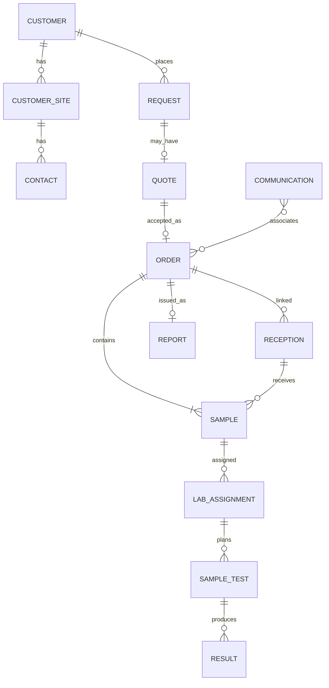

---

## 1 · Platform (MVP)

Owns org structure, sequences, settings, signer config. **Consumes** audit; does not own audit rows’ business meaning.

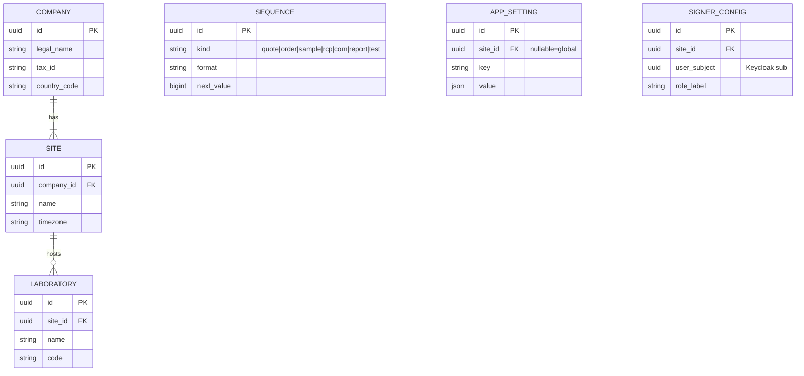

Authorization matrices (role × site × laboratory × test type) live here or in a dedicated authz package under platform — **not** in Keycloak as SoT.

---

## 2 · Customers (MVP mínimo)

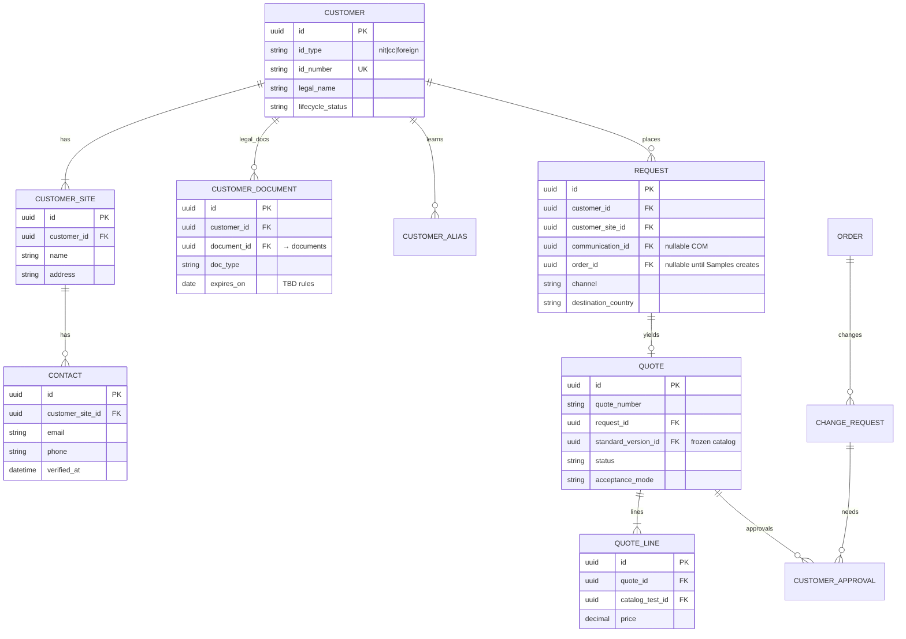

**TBD**: segmentación exacta (sector/nivel cuenta), política de precios sin respuesta del cliente.

---

## 3 · Catalog (MVP mínimo; vigilancia/IA F2)

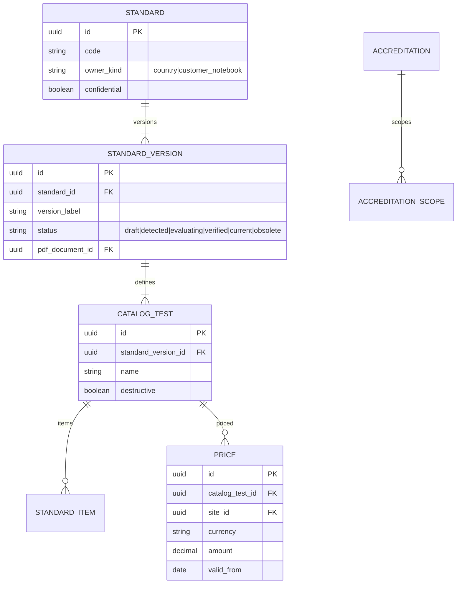

Consumers (**quote**, **sample_test**, **report**) store `standard_version_id` — never “whatever is current”.

---

## 4 · Samples (MVP; contramuestras F4)

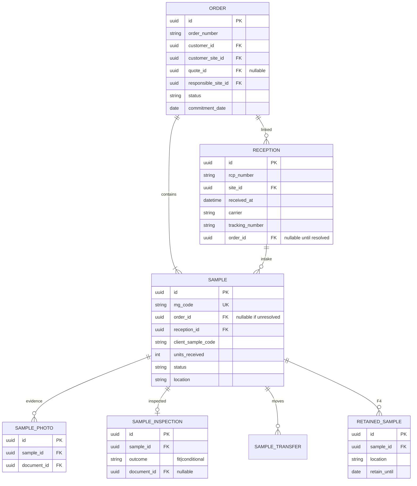

Reception package photos → `documents` with `reception_id`. Sample photos → `sample_id`. `order_id` filled when resolved (object key unchanged).

---

## 5 · Laboratory (F4 detail; frontier FKs from MVP)

No `customer_id`. Work by `sample` / `sample_test` codes only.

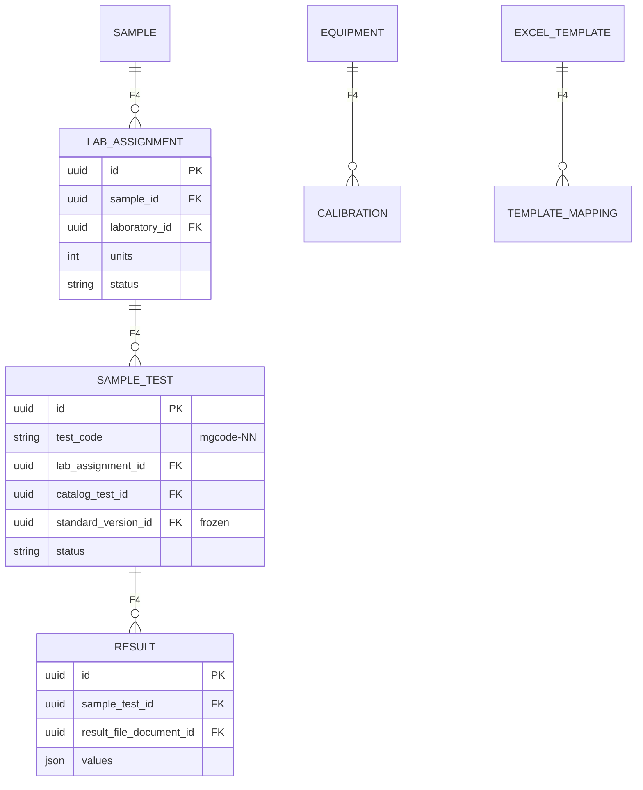

---

## 6 · Reports (F4; signer config from Platform MVP)

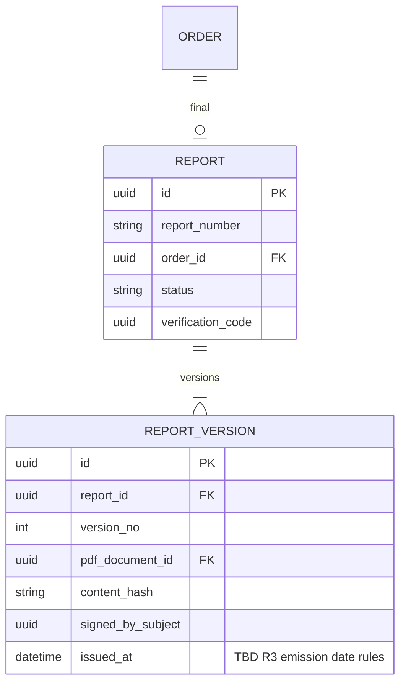

Issued PDFs → Object Lock capable prefix/bucket.

---

## 7 · Communications (MVP: COM + email; WhatsApp F3)

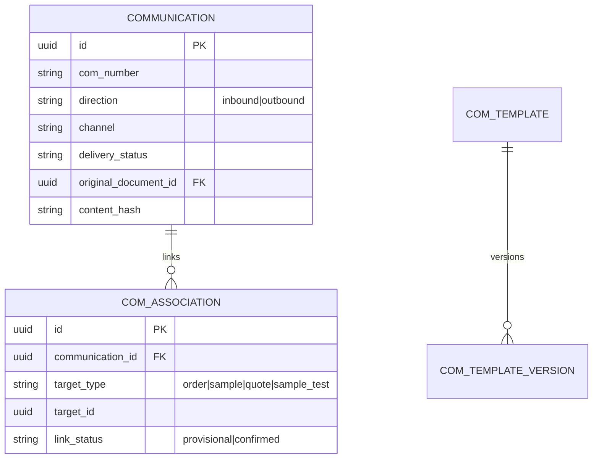

Outbound **send** is a command to `labsmyg-notifications` (SQS), not owned here.

---

## Transversal A · Audit (schema `audit`, MVP)

Same MySQL server, **logical schema/database `audit`**. App role: `INSERT` only.

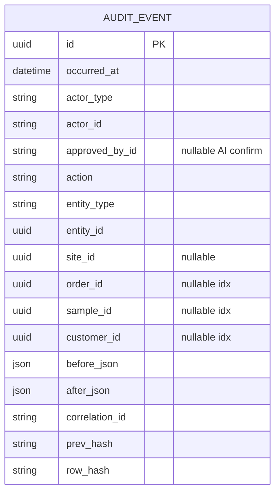

Daily export → S3 + Object Lock. **TBD**: retention years by record type.

---

## Transversal B · Documents (MVP)

Metadata in app DB; bytes in S3. Stable key by `document_id`.

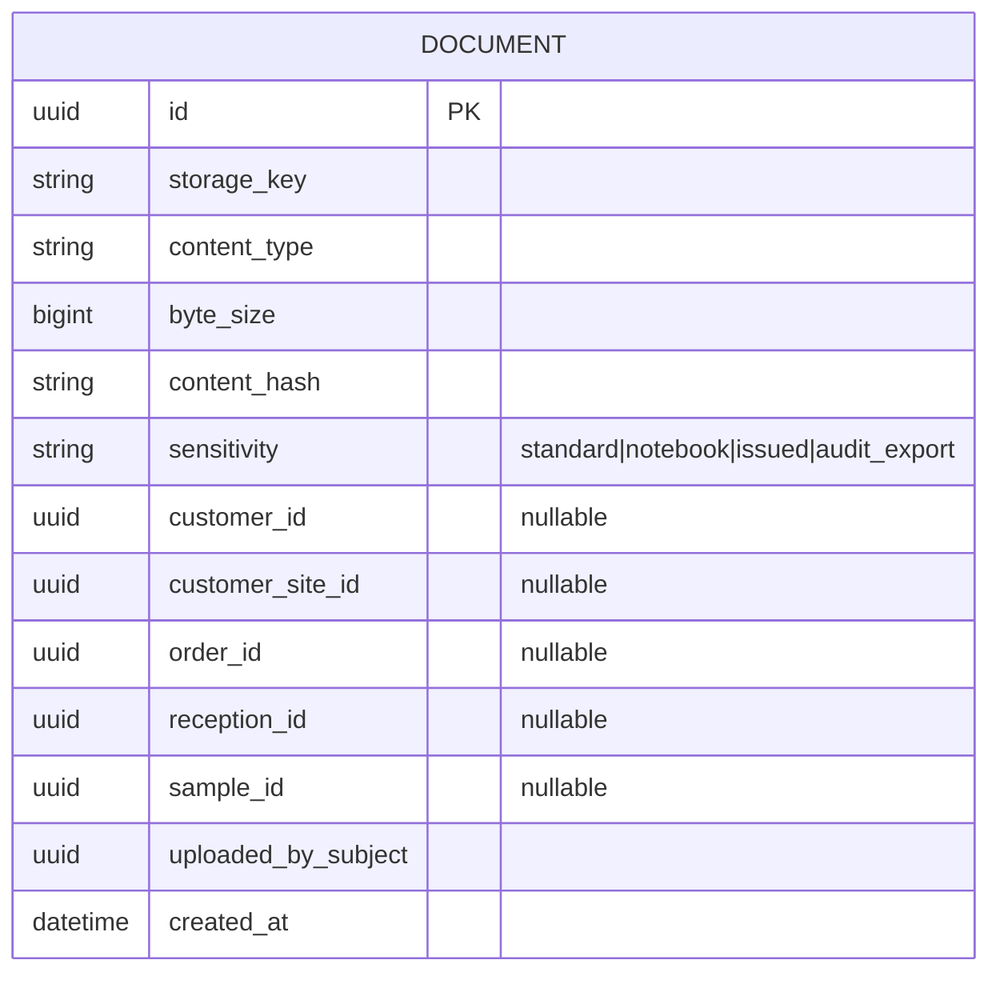

Suggested key prefixes (not a second SoT):

- `customers/{customer_id}/legal/{document_id}`
- `receptions/{reception_id}/{document_id}`
- `samples/{sample_id}/{document_id}`
- `orders/{order_id}/{document_id}`
- `reports/issued/{document_id}`

---

## Transversal C · Approvals & outbox (MVP)

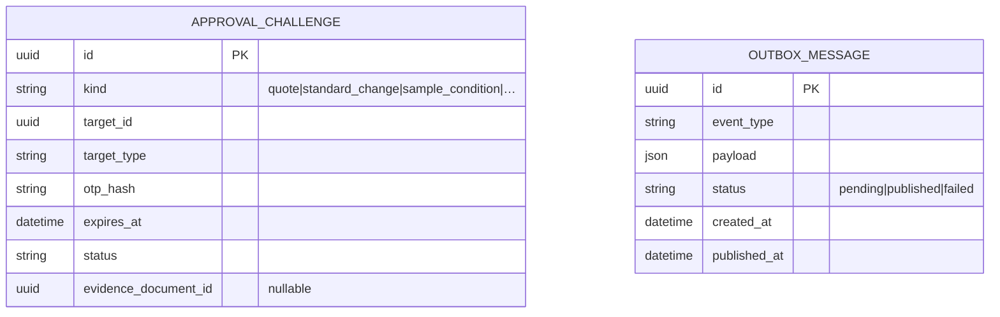

---

## MVP table set (checklist)

| Domain | MVP tables |
|--------|------------|
| Platform | company, site, laboratory, sequence, app_setting, signer_config, authz assignments |
| Customers | customer, customer_site, contact, customer_document, request, quote, quote_line, customer_approval |
| Catalog | standard, standard_version, catalog_test, standard_item, price |
| Samples | order, reception, sample, sample_photo, sample_inspection |
| Laboratory | *(frontier only / stubs)* |
| Reports | *(frontier only / stubs)* |
| Communications | communication, com_association, com_template(+version) |
| Transversal | audit.audit_event, document, approval_challenge, outbox_message |

---

## Open TBDs (do not invent)

- Audit / document retention years (Ley 1581 / lab policy)
- Report emission date rules (R3)
- Customer segmentation attributes final shape
- Exact e-invoicing / payment provider columns (ports)
- Whether authz is separate tables vs JSON policies (implementation choice in `004`)
